# 🚇 《車廂角落》Carriage Corner — 開發規格書（PRD）＆ 技術架構提案

> **同在，但不必言語。**
> 一節永遠在行駛的捷運車廂，裡面坐著和你一樣、正在努力或正在放空的陌生人。

| 項目 | 內容 |
|---|---|
| 專案名稱 | 《車廂角落》Carriage Corner（工作代號：Taipei Commute） |
| 文件版本 | v1.6 Draft |
| 撰寫日期 | 2026-11-04 |
| v1.1 變更 | 新增 2D 現代精緻像素風美術規格（§2.1–2.4、§2.10）；新增第 3 章法律避險與原創替代規範；路線／站名／品牌全面改為虛構（北城捷運 TPRT）；音訊改為原生 Web Audio（即時合成提示音＋CC0 低通鐵軌聲） |
| v1.2 變更 | 新增第 15 章：月台 ⇄ 車廂的進站流程、名字與性別、頭頂名字、換座位／站著拉吊環、跨車廂漫遊；依捷運禁止飲食規定移除咖啡，微光改為點頭致意／遞上微光／拍拍肩膀 |
| v1.3 變更 | 新增第 16 章：過場載入畫面、兩步驟閘門與進站車站選擇（月台路線圖看板）、車廂穿梭指示牌＋滑動動畫＋音效、底部選單中文標籤、車窗霧氣字雙層描邊；修正晨／夜切換時畫面停止渲染 |
| v1.4 變更 | 新增第 17 章：對其他乘客的四種互動（嗶卡默契、同頻波紋、蓋上小毯、遞幸運籤）取代三種微光；車窗留言改以螢幕解析度細筆劃繪製，加上動態字級與字距 |
| v1.5 變更 | 新增第 18 章：在轉乘站的月台直接走連通道換線（不必回閘門）；點乘客的互動選單改為只有像素圖示的環形輪盤 |
| v1.6 變更 | 新增第 19 章：連線時月台上的列車與伺服器同一班，走進車門就坐進正停在這站的那班車；車票的上車站因此正確 |
| 文件狀態 | 🟡 待團隊評審 |
| 平台 | Web（手機直式／電腦橫式響應式），免下載、免註冊 |
| 主要語系 | 繁體中文（zh-TW），次要英文 |

---

## 目錄

0. [TL;DR](#0-tldr)
1. [產品概述](#1-產品概述)
2. [世界觀與美術／音效方向](#2-世界觀與美術音效方向)
3. [⚖️ 法律避險與原創替代規範](#3-法律避險與原創替代規範)
4. [玩家流程與零壓力互動機制](#4-玩家流程與零壓力互動機制)
5. [功能模組拆解：MVP vs Future Scope](#5-功能模組拆解mvp-vs-future-scope)
6. [前端技術架構](#6-前端技術架構)
7. [後端與即時連線設計](#7-後端與即時連線設計)
8. [Threads 社群擴散機制](#8-threads-社群擴散機制)
9. [程式碼範例](#9-程式碼範例)
10. [非功能需求](#10-非功能需求)
11. [開發里程碑](#11-開發里程碑)
12. [風險與對策](#12-風險與對策)
13. [待決議事項](#13-待決議事項)
14. [附錄](#14-附錄)
15. [進站流程、角色自訂、車廂移動與禁食規則](#15-進站流程角色自訂車廂移動與禁食規則)
16. [UI/UX 優化](#16-uiux-優化載入畫面進站車站選擇車廂穿梭底部標籤霧氣字清晰度)
17. [互動選單與車窗字體](#17-互動選單與車窗字體)

---

## 0. TL;DR

| | |
|---|---|
| **一句話定位** | 打開網頁就坐進一節台北風格的虛構捷運「北城捷運 TPRT」車廂，和 8～12 位匿名陌生人「安靜地一起」工作、讀書或放空。 |
| **美術** | 2D 現代精緻像素風（32 × 32 場景網格／64 × 64 角色），Low-Fi 莫蘭迪低飽和色調，像素化光影與粒子 |
| **法律** | 全原創致敬：不使用任何官方 Logo、標準字、悠遊卡、官方錄音；路線站名皆虛構（見第 3 章） |
| **核心迴圈** | 取名、感應隨行卡進站 → 月台候車 → 點車門上車 → 就座或站著 → 切換狀態（🎧📖😴）→ 偶爾在車窗霧氣寫一句話、對人點頭致意 → 到站點車門下車 → 生成車票明信片分享到 Threads |
| **絕不做的事** | 自由聊天、私訊、好友、按讚、評分、排行榜、個人檔案 |
| **前端** | Vite + TypeScript + **PixiJS v8**（車廂渲染）+ **React + Tailwind**（UI 疊層）+ Zustand + **原生 Web Audio API**（即時合成提示音） |
| **後端** | Node.js（LTS）+ **Socket.io v4** + Redis；房間以「車廂」為單位、伺服器權威 |
| **部署** | 靜態資源 Cloudflare CDN；即時層部署於 **GCP asia-east1（彰化）**，台灣 RTT 最低 |
| **時程建議** | 7 週做完 MVP，**2026-12-28 上線，趕上跨年夜「高塔煙火限定班次」**作為第一波 Threads 爆點 |

---

## 1. 產品概述

### 1.1 願景

現代人的孤獨不是「沒有人可以說話」，而是「說話本身就很累」。《車廂角落》要提供的是**捷運車廂裡那種剛剛好的距離**：大家各做各的事，但你知道自己不是一個人。

### 1.2 目標使用者

| Persona | 情境 | 他們想要的 |
|---|---|---|
| 🧑‍💼 通勤上班族 | 早上開工前、午休、下班後 | 一個「開工儀式」與下班後的放空空間 |
| 🎒 學生／考生 | 讀書、準備考試 | 有人陪著的番茄鐘，但不想被打擾 |
| 💻 遠距工作者 | 在家一整天沒有人聲 | 背景白噪音與「有人在」的感覺 |
| 🌙 夜歸／失眠族 | 深夜睡不著 | 不需要社交的溫度 |
| ✈️ 海外台灣人 | 想家 | 熟悉的捷運聲響與台北風景 |

### 1.3 體驗支柱（Design Pillars）

1. **靜謐（Calm）**：所有動畫慢、音效柔、色彩暖；任何設計若讓人「心跳加快」就是錯的。
2. **同在（Presence）**：看得到別人在、在做什麼，但看不到他是誰。
3. **單向溫暖（One-way Kindness）**：善意可以送出，但永遠不要求回應，也不公開來源。
4. **在地記憶（Local Nostalgia）**：細節要讓台北人會心一笑（隔一個位子坐、博愛座、關門嗶聲）。

### 1.4 Non-Goals（明確不做）

- ❌ 自由文字聊天、私訊、語音
- ❌ 好友、追蹤、個人頁、等級
- ❌ 按讚數、收到的微光排行、任何公開數字比較
- ❌ 強迫登入、推播轟炸、每日任務、抽卡
- ❌ 會讓人「錯過就虧了」的限時壓力機制（限定班次是彩蛋，不是任務）

### 1.5 成功指標（上線後 30 天）

| 指標 | 目標 | 說明 |
|---|---|---|
| 平均單次停留 | ≥ 20 分鐘 | 陪伴型產品的核心健康度 |
| D7 留存 | ≥ 15% | 「回來搭車」的習慣 |
| 車票分享率 | ≥ 8% 工作階段 | 分享次數 ÷ 工作階段數 |
| K-factor | ≥ 0.3 | 每位玩家經分享帶來的新玩家 |
| 番茄鐘完成率 | ≥ 40% | 已完成 ÷ 已開始 |
| 留言檢舉率 | < 0.5% | 內容治理健康度 |

---

## 2. 世界觀與美術／音效方向

> 🎨 本章的路線、站名、標誌、票證與音效**全部採原創替代設計**，對照規則見[第 3 章 法律避險與原創替代規範](#3-法律避險與原創替代規範)。

### 2.1 美術風格：2D 現代精緻像素風（Modern Pixel Art）

**定義**：角色與場景是嚴格對齊網格的像素圖；光照、粒子、光暈則交給「現代」的即時渲染管線處理，但**一律在基準解析度上運算再整數放大**，確保光影本身也是像素顆粒，不會出現「像素圖上蓋一層高解析模糊光」的違和感。

| 項目 | 規格 |
|---|---|
| 網格 | 場景／道具：**32 × 32** tile；角色：**64 × 64** cell（角色本體約 28 × 52 px，保留空間給道具與粒子） |
| 基準解析度 | 橫式 **640 × 360**（20 × 11.25 tiles）／直式 **360 × 640** |
| 縮放 | 以**實體像素**（CSS 尺寸 × `devicePixelRatio`）計算最大整數倍率；Nearest-Neighbor 取樣；餘邊以當下環境色補滿，不拉伸、不做非整數縮放 |
| 座位節距 | 64 px（一個角色 cell），6 個座位＝ 384 px，其餘留給車門、立柱與貫通道 |
| 像素紀律 | 禁止混合像素尺寸（mixels）；精靈不做任意角度旋轉與非整數縮放；所有位置對齊整數像素 |
| 輪廓 | 選擇性輪廓（sel-out）：用比填色深一階的同色系描邊，**不使用純黑** |
| 抖色（Dithering） | 僅用於天空漸層與光照衰減邊緣，角色與 UI 不抖色 |
| 調色盤 | 一份 **48 色主調色盤**（含晨／夜兩組明度），所有素材只能從中取色 |
| 中文字型 | 像素字型：**俐方體 11 號（Cubic 11）** 或 **縫合像素字體（Fusion Pixel）**，皆為 OFL 授權；依實際用字子集化 |
| 製作工具 | Aseprite（原始檔 `.aseprite` 入版控）→ Aseprite CLI 匯出 Sprite Atlas（PNG＋JSON） |

### 2.2 色彩系統：Low-Fi 莫蘭迪低飽和色調

**規則**

1. 一般色塊飽和度控制在 **HSL 15%～35%**，靠「明度差」而不是「彩度差」建立層次與可讀性。
2. 唯一允許「亮」的是**光**：霓虹、車廂燈、微光互動可提高明度，但飽和度仍 ≤ 45%，亮度感交給 Bloom 光暈。
3. 晨間偏暖灰（奶茶、燕麥、霧藍），夜間偏冷灰紫（煙紫、石板藍），再用暖黃燈光點綴。

| Token | 🌅 晨間 | 🌃 夜間 | 用途 |
|---|---|---|---|
| `--bg` | `#E8E1D5` 燕麥 | `#3A3846` 煙紫 | 車廂牆面／底色 |
| `--sky` | `#D9DFE2` 霧白藍 | `#2E3242` 夜石板 | 天空 |
| `--light` | `#E6C9A8` 奶茶光 | `#D9B98C` 暖燈黃 | 陽光／車廂燈 |
| `--seat-blue` | `#8FA3B5` 霧藍 | `#6B7D8E` | 藍色塑料座椅 |
| `--seat-yellow` | `#D8C49A` 燕麥黃 | `#A89878` | 黃色塑料座椅 |
| `--priority` | `#5F6F86` 深霧藍 | `#4C5868` | 博愛座 |
| `--metal` | `#B8B4AC` | `#7D7B80` | 立柱、吊環、門框 |
| `--ink` | `#4A4744` | `#E9E2D6` | 文字、輪廓基準 |
| `--neon-1` | — | `#C98BA0` 乾燥玫瑰 | 霓虹光暈 |
| `--neon-2` | — | `#7FA9A3` 灰綠 | 霓虹光暈 |
| `--neon-3` | — | `#D4A373` 琥珀 | 霓虹光暈 |
| `--glow` | `#F3E9DA` | `#F1E3CF` | 微光互動 |

### 2.3 角色動畫（2～4 幀極簡動態）

動作越少越安靜：每個狀態只用 2～4 幀，**每幀停留 400～800 ms**，讓角色像在呼吸而不是在「表演」。

| 狀態 | 幀數 | 每幀時長 | 動作 | 附加粒子 |
|---|---|---|---|---|
| `idle` 看窗外 | 2 | 700 ms | 呼吸：肩膀上下 1 px | — |
| `music` 戴耳機 | 2 | 約 400 ms（對齊 Lo-Fi 約 75 BPM） | 輕微點頭 1 px | 偶爾飄出一個音符 |
| `read` 閱讀 | 2（＋1 翻頁幀） | 800 ms | 低頭閱讀；每 20～40 秒翻頁一次 | — |
| `sleep` 補眠 | 4 | 600 ms | 頭慢慢垂下→頓一下→回正 | 💤 Zzz |
| `stand`／`walk` 站立／走路 | 2／2 | 800／180 ms | 月台上候車、走動（v1.2，§15.1） | — |
| `hang` 拉吊環 | 2 | 900 ms | 站在走道上舉手握吊環（v1.2，§15.3） | — |

> v1.2：依捷運禁止飲食規定，移除 `coffee` 喝咖啡狀態與咖啡熱氣粒子。

**Sprite Sheet 規格**

- 4 種穿搭 × 2 種性別 × 2 個視角（正面／背影）× 7 個動作 × 2～4 幀 ≈ **270 幀**（v1.2），單張 Atlas 即可容納。
- **調色盤交換（Palette Swap）**：每個外觀預留 3 個可換色槽（上衣、下身、配件），由 Shader 從莫蘭迪色組替換，**不增加任何美術工時**就有 8 種以上配色。
- 滑鼠懸停／鍵盤聚焦乘客時，以 1 px 柔光描邊提示可互動。

### 2.4 光影與粒子效果

| 效果 | 行為 | 實作 | 上限 | 「減少動態」時 |
|---|---|---|---|---|
| 🌧 窗外雨絲 | 斜向雨絲，列車越快傾斜越大 | `ParticleContainer`，1 × 3～6 px 線段 | 120 | 降為 40，不傾斜 |
| 💧 玻璃水珠 | 隨機附著→累積→沿玻璃蛇行滑落並留下短暫水痕；兩顆相遇會合併加速 | 每扇窗獨立的輕量粒子系統；水痕寫入 RenderTexture 逐步淡出 | 每窗 24 | 只保留靜止水珠 |
| 🌫 水蒸氣霧氣 | 車窗下緣較濃、緩慢流動；寫字處被擦開、再慢慢重新凝結 | 霧貼圖＋雜訊位移 Filter＋留言反向遮罩 | — | 霧氣靜止 |
| 🌃 霓虹光暈 | 夜間窗外招牌經過時，色光**透過窗框形狀**掃過座椅與地板，邊緣帶 2 階抖色 | 光照緩衝區繪製「窗形光斑」，依視差速度平移，加算混合 | 同時 3 光源 | 改為緩慢漸變色 |
| ☀️ 晨間光柱 | 斜射光柱隨列車轉彎緩慢移動，光中有浮塵 | 光照緩衝區＋1 px 浮塵粒子 | 浮塵 30 | 光柱靜止 |
| 🚇 隧道燈掃光 | 燈光從窗外掃過車廂內部 | 光照緩衝區矩形掃光，頻率 < 3 Hz | — | 改為柔和明暗 |
| 💤 Zzz | 小字 Z 緩慢上飄 | 3 顆粒子 | 3／人 | 保留 |
| ✨ 微光互動 | 頭頂柔光 1 秒＋6 顆光點 | 光照緩衝區＋粒子 | 6／次 | 只保留柔光 |

**像素化渲染管線**

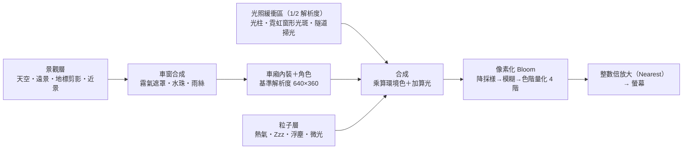

> **像素化 Bloom** 的關鍵是最後的「色階量化」：模糊後的光暈只保留 4 個亮度階，放大後仍呈現一圈一圈的像素光環，而不是平滑的數位柔焦。

### 2.5 車廂構成與座位表

車廂採**側視剖面**：遠側長椅（A 排）正面朝向鏡頭、背後是車窗；近側長椅（B 排）以背影呈現於前景。

```
   ┌──────── 車門上方 LED 路線圖（原創像素線條＋虛擬站名）────────┐
   ║ 窗 1 ║ 窗 2 ║ 窗 3 ║ 窗 4 ║ 窗 5 ║ 窗 6 ║   ← 景觀 + 霧氣留言
     ⌇    ⌇    ⌇    ⌇    ⌇    ⌇    ⌇    ⌇         ← 吊環（隨加減速微晃）
   [1A♿][2A ][3A ][4A ][5A ][6A♿]                ← A 排（正面）
  ════════════════ 走道 ════════════ ┃立柱 ┃ 貫通道 ⇄ 隔壁車廂
   [1B♿][2B ][3B ][4B ][5B ][6B♿]                ← B 排（背影、前景）
```

- **12 個座位 = 房間上限 12 人**。其中 `1A／6A／1B／6B` 為**博愛座**（深霧藍＋原創像素圖示）。
- **8 個一般座 = 理想密度 8 人**（見 §7.4 分流邏輯，數字彼此呼應）。
- 座椅顏色依路線：城心線、雲橋線為霧藍塑料椅；河岸線為燕麥黃塑料椅。
- 匿名代號直接取座位：**`Seat 3B`**。

### 2.6 路線與車窗景觀（北城捷運 TPRT・虛構路網）

| 路線 | 代號／色 | 區段特性 | 車窗景觀 | 代表時刻 |
|---|---|---|---|---|
| 城心線 City Core Line | `CX` `#7C93A8` 霧藍 | 幾乎全線地下 | 隧道燈規律飛逝、虛構品牌廣告牆、車窗變鏡面映出車廂 | 下班尖峰的城市心跳 |
| 河岸線 Riverside Line | `RV` `#B97A6F` 乾燥玫瑰 | 地下→出隧道→高架河岸 | 「紅柱山」出隧道瞬間、紅柱宮殿式飯店剪影、河口紅樹林、遠山 | 🌇 河口夕照 |
| 雲橋線 Skybridge Line | `SK` `#A89170` 卡其棕 | 高架為主，中段短暫地下 | 「城市之塔」剪影、湖畔天際線、機場跑道燈 | 🎆 跨年高塔煙火 |

**虛擬站名（MVP 每線 7 站，到終點折返）**

```
城心線 CX ──●西城口──●茶行街──◎中央站──●書肆巷──●榕樹下──●東城──◎展覽館
河岸線 RV ──◎中央站──●老城──●紅柱山──●芝蘭──●溫泉谷──●渡口──●夕照
雲橋線 SK ──●茶山──●科技橋──●高塔前──●雲端──●湖畔──●機場邊──◎展覽館
                                                  ◎ = 轉乘站
```

> 站名刻意「喚起感覺」而非對應真實站點；地標一律以**剪影與色塊**呈現，畫面與文案都不出現真實建物名稱、商標或官方燈光秀圖案（見第 3 章）。

**景觀分層（由遠到近，視差速度遞增）**

1. 天空漸層＋太陽／月亮（依真實時間移動）
2. 遠景山稜／天際線
3. 地標剪影（城市之塔、紅柱飯店、遠山）
4. 近景：電線桿、行道樹、隔音牆
5. 地下段專用：隧道燈（間距固定、閃爍 < 3 Hz）、虛構品牌廣告牆
6. 車窗玻璃層：霧氣、水珠、雨絲、夜間／地下段的車廂倒影

**區段類型**：`underground`（地下）、`elevated`（高架／地面）、`portal_up`（出隧道）、`portal_down`（入隧道）。`portal_up` 是每條路線的「高光時刻」：光線瞬間灌進車廂、鐵軌聲的低通濾鏡同步打開。

### 2.7 時間模式

| 模式 | 時段 | 光線 | 氛圍 |
|---|---|---|---|
| 🌅 晨間 | 06:00–17:00 | 奶茶色斜射光柱在地板上緩慢移動、浮塵 | 開工、專注 |
| 🌃 夜間 | 17:00–06:00 | 夕照→城市霓虹窗形光斑，車廂燈暖黃 | 下班、放空 |

- **轉場**：邊界前後各 15 分鐘在晨／夜兩組調色盤之間插值（Palette Lerp），避免「啪」一聲切換。
- **時間來源**：預設採**裝置本地時間**；設定中提供「以台北時間顯示」給海外使用者（見 §13 待決議）。
- **深夜彩蛋（Future）**：00:00–06:00 為「末班車後的夢幻班次」，車窗外是星空版北城。

### 2.8 版面配置（Wireframe）

**閘門（入口）**

```
┌──────────────────────────────────┐
│   [T] 北城捷運 TPRT                │
│          車  廂  角  落            │
│         Carriage Corner           │
│                                   │
│  今天想搭哪條線？                  │
│  ( CX 城心 ) ( RV 河岸 ) ( SK 雲橋 ) │
│  你是哪一位乘客？                  │
│  [👔] [🎒] [🧥] [🎧]              │
│  選一張隨行卡 PassCard：           │
│  [▦花磚] [🧋珍奶] [🍚電鍋] [🥭芒果冰] │
│                                   │
│      ┌──────────────────────┐     │
│      │  嗶！感應隨行卡進站   │     │  ← 同時解鎖瀏覽器音訊
│      └──────────────────────┘     │
│   不需註冊・完全匿名・沒有聊天室    │
└──────────────────────────────────┘
```

**橫式（電腦）**

```
┌──────────────────────────────────────────────────────────────┐
│ ● CX 城心線 往展覽館        下一站 ▸ 書肆巷       🌃 21:47  ⚙ │
├──────────────────────────────────────────────────────────────┤
│ ║今天也要║        ║  ▲塔   ║        ║ ~雨~  ║        ║        │
│ ║好好吃飯║        ║        ║        ║       ║        ║        │
│   ⌇   ⌇   ⌇   ⌇   ⌇   ⌇   ⌇   ⌇                              │
│ [1A♿][2A📖][3A  ][4A😴][5A☕][6A♿]                           │
│ ════════════════════════════════════ ┃                       │
│ [1B♿][2B  ][3B★你][4B🎧][5B  ][6B♿]                          │
├──────────────────────────────────────────────────────────────┤
│  ☕  🎧  📖 18:42  😴           🎚 音效      🎫 我的車票       │
└──────────────────────────────────────────────────────────────┘
```

**直式（手機）** — MVP 沿用同一套美術，以「垂直堆疊＋座位列左右滑動」適配

```
┌──────────────────────┐
│ CX 往展覽館        ⚙ │
│ ▸ 書肆巷      21:47  │
├──────────────────────┤
│                      │
│   車窗景觀＋霧氣留言   │  ~40%
│                      │
├──────────────────────┤
│ ◀ [2A📖][3A ][4A😴] ▶ │  ~35%（預設置中於自己座位）
│   [2B  ][3B★][4B🎧]  │
├──────────────────────┤
│  ☕   🎧   📖   😴    │
│  🎚 音效     🎫 車票   │
└──────────────────────┘
```

> Future：直式改為「沿走道一點透視」構圖（左右兩排長椅向遠方延伸），更有電影感，但需另一套美術。
>
> **載入速度**：閘門畫面以內嵌 HTML／CSS 呈現（不等 JS），玩家選路線、選卡片的幾秒內在背景預載車廂 Atlas；按下「感應進站」時資源多半已就緒，轉場以毫秒計。完整預算見 §6.5。

### 2.9 環境音效（ASMR Mixer・全原創／CC0）

| 頻道 | 類型 | 來源 | 處理 | 預設 |
|---|---|---|---|---|
| 🚃 鐵軌行駛底音 | 循環 | **CC0 鐵道行駛錄音**（逐檔登記授權） | **低通濾鏡**：地下約 700 Hz（悶）、高架約 4.5 kHz（亮），區段切換時 3 秒滑動；地下段疊加短殘響 | 開 |
| 🌧 車窗雨聲 | 循環 | CC0 或自行錄製 | 高通 120 Hz 去除低頻轟鳴；開啟時車窗同步出現雨絲與水珠 | 關 |
| 🎹 Lo-Fi 鋼琴 | 循環 | 委託原創（取得著作財產權）或 CC0 | 到站提示時自動壓低（ducking） | 關 |
| 🔔 關門警示音 | 事件・**即時合成** | Web Audio `OscillatorNode` | **800 Hz ⇄ 1000 Hz 簡短交替**（規格見第 3 章） | 開 |
| 🎫 感應進站聲 | 事件・**即時合成** | Web Audio `OscillatorNode` | 1200 Hz 單音 90 ms | 開 |
| 📢 到站廣播 | 事件 | **原創配音或 TTS 預先渲染** | 「車廂喇叭」濾鏡：高通 300 Hz＋低通 3.4 kHz＋輕微飽和失真＋短殘響 | 開 |

**音檔規格**：48 kHz；Opus（`.webm`）＋ AAC（`.m4a`）雙格式；**循環音檔不使用 MP3**（編碼器補靜音會造成接縫）；響度正規化至約 -20 LUFS；鐵軌底音首載，其餘按需載入。提示音採即時合成，**零下載量**。

### 2.10 美術資產清單（MVP）

| 類別 | 內容 | 規格 | 數量 |
|---|---|---|---|
| 角色 | 4 外觀 × 2 視角 × 5 狀態 | 64 × 64 cell，2～4 幀 | 約 100 幀 |
| 車廂內裝 | 牆面、座椅（藍／黃／博愛座）、吊環、立柱、車門、貫通道、LED 路線圖框 | 32 × 32 tile | 1 套＋座椅換色 |
| 景觀 | 天空（晨／夜）、遠山、城市天際線、3 組地標剪影、近景物件 | 可水平循環拼接 | 3 線 × 2 時段 |
| 地下段 | 隧道壁、隧道燈、廣告牆（6 則虛構品牌廣告） | 32 × 32 tile | 1 套 |
| 車窗 | 霧氣雜訊貼圖、水珠精靈、窗框光斑形狀 | — | 1 套 |
| 粒子 | 雨絲、水珠、熱氣、Zzz、音符、浮塵、光點 | 1～8 px | 1 套 |
| 品牌 | TPRT 幾何 T 標誌、4 款隨行卡卡面 | 32 × 32 標誌、128 × 80 卡面 | 1＋4 |
| UI | 狀態按鈕、音效推桿、番茄鐘環、車票明信片框（晨／夜） | 像素 9-slice | 1 套 |


---

## 3. 法律避險與原創替代規範

> ⚠️ **極重要**：本章是全體美術、音效、文案與行銷的**硬性規範**。任何素材進版控前都要符合本章，否則不得合併。

### 3.1 基本原則：原創致敬（Homage），而非「改名照用」

- **台灣著作權法沒有獨立的「戲仿（Parody）」免責條款**，戲仿是否合法要回到第 65 條合理使用的四項因素個案判斷；商標法則看有無「致相關消費者混淆誤認之虞」。因此本專案**不依賴「這是戲仿」作為抗辯**，而是讓所有素材本身就是原創。
- **可保留的是「意象」**：長椅、吊環、立柱、藍／黃塑料座椅、博愛座較深的配色、車廂貫通、關門前有提示音「這個概念」——這些屬於大眾運輸的通用設計語彙。
- **不可使用的是「元素」**：特定標誌、標準字、識別系統版式、票卡卡面、官方錄音、官方廣播句型與真實品牌名稱。

**🚫 絕對禁止清單**

| # | 禁止項目 |
|---|---|
| 1 | 臺北捷運（TRTS／Taipei Metro）官方 Logo、標準字、指標系統版式（路線色＋站碼圓標的站名牌樣式） |
| 2 | 悠遊卡（EasyCard）名稱、商標、卡面設計、感應器外觀 |
| 3 | 官方關門警示音、到站廣播、任何在捷運內錄到且含有官方音訊的錄音 |
| 4 | 真實路線名、站名、站碼（`BL`、`R`、`BR` 等）用於遊戲畫面或行銷素材 |
| 5 | 真實地標的**名稱與商標**（如「台北 101／TAIPEI 101」「圓山大飯店」）作為畫面標示或活動名稱 |
| 6 | 真實品牌出現在廣告牆、貼紙、卡面（含「大同」字樣與其商標） |

### 3.2 真實 → 遊戲內原創替代對照表

| 類別 | 真實（禁止使用） | 遊戲內原創替代 |
|---|---|---|
| 營運單位 | 臺北捷運／TRTS／Taipei Metro | **北城捷運**／**TPRT** |
| 標誌 | 官方標誌 | **原創幾何 T 字像素標誌**（§3.3） |
| 標準字 | 官方字體與指標字型 | 俐方體 11 號／縫合像素字體（OFL） |
| 票證 | 悠遊卡 EasyCard | **隨行卡 PassCard**（備選：漫遊卡） |
| 路線 | 板南線、淡水信義線、文湖線 | 城心線 `CX`、河岸線 `RV`、雲橋線 `SK` |
| 站名 | 真實站名 | 虛擬站名（西城口、中央站、紅柱山、夕照…） |
| 站名牌 | 官方版式 | 原創像素圓角方標 |
| 路線圖 | 官方路網圖 | 簡化版原創像素線條路線圖 |
| 地標 | 台北 101、圓山大飯店 | 「城市之塔」「紅柱飯店」**剪影**（不標名稱、不含商標） |
| 廣告牆 | 真實品牌 | 虛構品牌（如「雲朵豆花」「巷口洗衣」「慢慢書店」） |
| 博愛座標示 | 官方貼紙圖樣 | 原創像素圖示 |
| 關門警示音 | 官方錄音 | Web Audio 即時合成 800 Hz ⇄ 1000 Hz |
| 到站廣播 | 官方錄音與句型 | 原創配音／TTS，口語化句型 |
| 行駛環境音 | 官方或來源不明錄音 | CC0 素材＋低通濾鏡 |

> 地標說明：依著作權法第 58 條，長期展示於戶外公開場所的建築著作原則上可被利用，因此**以剪影描繪城市天際線**風險較低；但建物名稱與 Logo 屬商標範疇，畫面、車票與行銷文案一律不使用。跨年活動對外名稱使用「跨年高塔煙火」。

### 3.3 北城捷運 TPRT 標誌規範

**命名**

- 中文主名：**北城捷運**。
- 英文縮寫：**TPRT**。⚠️ 若英文全稱寫作「Taipei Rapid Transit」，與官方英文名稱過於接近，有混淆誤認疑慮；**建議全稱改為「The Pixel Rapid Transit」**，保留 TPRT 縮寫又帶出遊戲屬性（待法務確認，見 §13）。

**標誌設計：幾何 T 字像素標誌**

```
16 × 16 網格示意（■ = 墨色，□ = 留白）

□□□□□□□□□□□□□□□□
□■■■■■■■■■■■■■■□   ← T 的橫筆：車廂頂／月台
□■■■■■■■■■■■■■■□
□□□□□□■■■■□□□□□□
□□□□■□■■■■□■□□□□   ← 兩側短橫：枕木（軌道意象）
□□□□□□■■■■□□□□□□
□□□□■□■■■■□■□□□□
□□□□□□■■■■□□□□□□
□□□□■□■■■■□■□□□□
□□□□□□■■■■□□□□□□
□□□□■□■■■■□■□□□□
□□□□□□■■■■□□□□□□
□□□□□□■■■■□□□□□□
□□□□□□□□□□□□□□□□
```

| 規格 | 內容 |
|---|---|
| 正式尺寸 | 32 × 32 網格（上圖為 16 × 16 縮略示意） |
| 色彩 | 主版：墨色 `#4A4744` ＋燕麥底 `#E8E1D5`；反白版；路線色版（CX／RV／SK） |
| 最小尺寸 | 16 px；四周留白 ≥ 2 個網格單位 |
| 禁止 | 圓形外框＋路線色環（易與官方站碼圓標混淆）、漸層、非整數縮放 |
| 驗收 | 定稿後與官方標誌並列比對，確認形狀、配色與構圖無混淆誤認之虞 |

### 3.4 隨行卡 PassCard 規範

- **名稱**：隨行卡 PassCard（備選：漫遊卡）。上線前完成商標檢索（§13）。
- **定位**：閘門畫面選擇的「卡面」是玩家唯一可自選的裝飾，也會印在車票明信片上，成為分享時的個人化元素。
- **卡面規格**：128 × 80 px（約 ISO 卡片比例），莫蘭迪色，像素風。
- **MVP 四款卡面**

| 卡面 | 意象 | 注意事項 |
|---|---|---|
| ▦ 四色花磚 | 台灣老屋花磚的原創四色像素圖騰 | 圖案需原創繪製，不臨摹特定博物館館藏或廠商圖樣 |
| 🧋 像素珍奶 | 一杯珍珠奶茶的像素貼紙 | 不出現任何飲料品牌名或杯身 Logo |
| 🍚 像素電鍋 | 一台「通用造型」電鍋 | **不使用「大同」字樣、商標與其招牌花色**；造型簡化為通用電鍋 |
| 🥭 像素芒果冰 | 一盤芒果冰 | 不出現店家名稱 |

- **禁止**：模仿悠遊卡的版面配置、晶片／感應圖示樣式、角落 Logo 位置；閘門感應器外觀需原創。

### 3.5 車廂細節：保留意象、原創繪製

| 保留的意象 | 原創化做法 |
|---|---|
| 藍／黃塑料長椅 | 依莫蘭迪色重新設計座椅造型與分隔線 |
| 博愛座較深配色 | 使用深霧藍；標示為原創像素圖示（不臨摹官方貼紙） |
| 中央立柱與吊環 | 自行設計吊環形狀與立柱分歧造型 |
| 車門上方路線圖 | **簡化版原創像素線條**＋虛擬站名＋原創站名方標；以 LED 點陣動畫顯示「下一站」 |
| 車廂貫通道 | 保留 |
| 車門貼紙、安全標示 | 全部原創像素圖示與文案 |

### 3.6 原創音效規範

**① 關門警示音（即時合成）**

| 參數 | 規格 |
|---|---|
| 產生方式 | Web Audio API `OscillatorNode` 即時合成（不使用任何錄音） |
| 頻率 | **800 Hz ⇄ 1000 Hz 簡短交替** |
| 節奏 | 每音 150 ms、間隔 30 ms，共 8 音（約 1.4 秒） |
| 音色 | 三角波，經 2.5 kHz 低通柔化，比一般提示音更圓潤 |
| 包絡 | 每音 5 ms 起音／釋音，避免爆音 |
| 音量 | 約 -18 dBFS，播放時 Lo-Fi 同步壓低 |
| 驗收 | **只依本表參數製作，不以官方錄音作為參考樣本**；完成後由非開發成員盲聽比對，確認可與官方提示音清楚區辨 |

**② 車廂環境音（CC0 素材＋低通濾鏡）**

- 只採用**明確標示 CC0** 的鐵道行駛錄音（例如 Freesound 以授權條件篩選 CC0、OpenGameArt 的 CC0 分類），**逐檔**到原始頁面確認授權後登記（§3.7）。
- ⚠️ **在台北捷運車廂內錄製的 CC0 素材，若背景含官方廣播或關門音，上傳者無權將該部分釋出為 CC0**——這類片段必須剪除，或直接改用其他素材。
- 以低通濾鏡統一音色並對應區段：地下約 700 Hz、高架約 4.5 kHz；同一段素材即可演繹兩種空間感。

**③ 到站廣播（原創配音／TTS）**

| 項目 | 規範 |
|---|---|
| 聲音來源 | 委託配音員錄製（簽約取得著作財產權與表演利用授權），或使用**條款明確允許商業使用**的 TTS 服務 |
| 產製方式 | 建置時預先渲染成音檔（每站一句），不在執行期呼叫 TTS，確保音色一致且無額外成本 |
| 語言 | 華語＋英語兩種；**不仿照官方的多語輪播順序** |
| 句型 | 口語、溫柔，與官方句型保持差異 |
| 濾鏡 | 「車廂喇叭」質感：高通 300 Hz＋低通 3.4 kHz＋輕微飽和失真＋短殘響 |

**句型範例**

| ✅ 本作原創句型 | ❌ 避免的官方式句型結構 |
|---|---|
| 「我們快到書肆巷了。下車的朋友，慢慢來，記得帶走隨身物品。」 | 「下一站，○○。」 |
| 「Almost at Shusi Lane. Take your time.」 | 「Next station, ○○.」 |
| 「列車要出發了，想再坐一會兒也沒關係。」 | 「車門即將關閉，請勿強行進出。」 |

**④ 音樂**：Lo-Fi 鋼琴委託原創（合約載明著作財產權讓與或專屬授權，並約定不行使著作人格權），或使用 CC0 曲目。

### 3.7 授權登記與上線前法務檢核

**素材授權登記表**（`assets/LICENSES.md`，每一個外部素材一列，CI 檢查新增素材必須有對應登記）

| 檔案 | 類型 | 來源網址 | 作者 | 授權 | 取得日期 | 修改內容 |
|---|---|---|---|---|---|---|
| `audio/rail_loop.webm` | 環境音 | （原始頁面網址） | （作者） | CC0 1.0 | 2026-11-10 | 剪輯循環點、響度正規化 |
| `fonts/cubic11-subset.woff2` | 字型 | （原始頁面網址） | （作者） | OFL 1.1 | 2026-11-10 | 子集化 |

**上線前檢核清單**

- [ ] 經濟部智慧財產局商標檢索：「車廂角落」「北城捷運」「TPRT」「隨行卡」「PassCard」
- [ ] TPRT 英文全稱定案（建議「The Pixel Rapid Transit」）
- [ ] TPRT 標誌、隨行卡卡面與官方識別並列比對紀錄
- [ ] 關門警示音盲聽區辨測試紀錄
- [ ] `LICENSES.md` 與實際打包檔案一致；OFL 字型授權聲明隨網站提供
- [ ] 配音／作曲合約歸檔；TTS 服務條款截圖存檔
- [ ] 全站與行銷素材掃描：不得出現 §3.1 禁止清單中的名稱與標誌
- [ ] 頁尾與「關於」頁放置免責聲明
- [ ] 設立權利人聯絡信箱，**48 小時內回應**下架或修改請求

**免責聲明（頁尾與「關於」頁）**

> 《車廂角落》為獨立原創作品。「北城捷運」「TPRT」「隨行卡」及遊戲內所有路線、站名、標誌與票證皆為虛構，與臺北大眾捷運股份有限公司、悠遊卡股份有限公司及任何真實營運單位或品牌無關。

---

## 4. 玩家流程與零壓力互動機制

### 4.1 使用者旅程

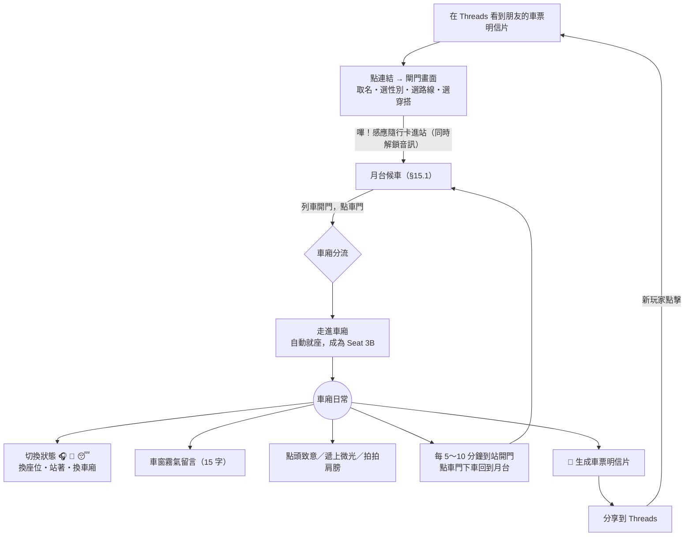

### 4.2 進站與身分

- **無註冊**：首次進站在 `localStorage` 產生匿名 `sid`；伺服器回傳簽章過的 `resumeToken` 供斷線重連。
- **外觀**：閘門選 4 種剪影之一（上班族、學生、連帽外套、耳機族），服裝色由伺服器隨機微調。
- **入場方式**：
  - 自己：看到車門開啟、走進、坐下（約 2 秒）。
  - 其他人：看到新乘客**從隔壁車廂經貫通道走進來**（捷運車廂相通，行駛中有人走過來是真實場景，因此不必等到站才能加入）。

### 4.3 狀態系統

| 狀態 | 圖示 | 動畫 | 附帶行為 |
|---|---|---|---|
| `idle` 看窗外 | — | 偶爾轉頭、眨眼 | 進場預設 |
| `music` 戴耳機 | 🎧 | 輕微點頭 | 自動展開音效面板（白噪音） |
| `read` 閱讀 | 📖 | 翻頁 | 啟動 25 分鐘番茄鐘 |
| `sleep` 補眠 | 😴 | 頭慢慢點下、Zzz | 掛機；電量節省模式 |

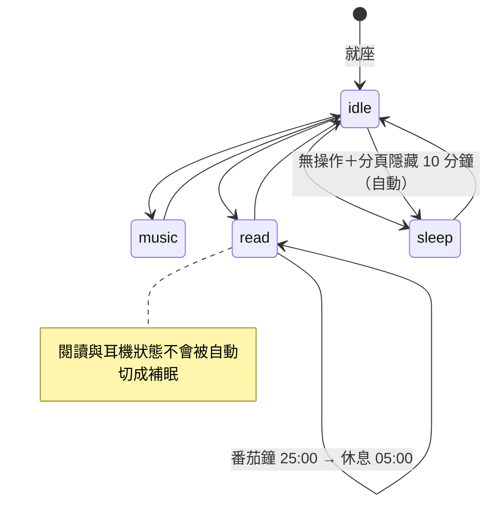

> 任意狀態之間皆可手動直接切換，上圖僅示意主要路徑與自動規則。

### 4.4 番茄鐘

- 預設 25 分鐘專注／5 分鐘休息，可在設定改為 50／10。
- **進度環只有自己看得到**；別人只看到你在讀書 📖。
- 以「開始時間戳」計算剩餘時間（不依賴 `setInterval`），分頁在背景被節流也不會走歪。
- 分頁標題顯示倒數（`📖 18:42 · 車廂角落`），完成時播放柔和鈴聲；可選擇授權瀏覽器通知。
- 完成數只記在本機，用於車票明信片，**不上傳、不排名**。

### 4.5 車窗霧氣留言（Steam Window Notes）

| 規則 | 規格 |
|---|---|
| 觸發 | 點擊自己座位後方的車窗（B 排玩家使用對面最近的窗） |
| 長度 | **最多 15 字**，以 `Intl.Segmenter` 依字素計算（emoji 算 1 字） |
| 文案模式 | 🌅 晨間提示「本日宣言：今天我要……」／🌃 夜間提示「此刻心情：……」 |
| 可見範圍 | 僅同車廂 |
| 生命週期 | 寫下後清晰 20 秒 → 約 8 分鐘內被霧氣重新凝結覆蓋 → 消失 |
| 數量 | 每扇窗同時最多 1 則；6 扇窗都有字時，最舊的一則加速消散 |
| 不可做 | 按讚、回覆、引用、看到作者是誰 |
| 頻率限制 | 每人每站 1 則、每 10 分鐘最多 3 則 |
| 治理 | 送出前伺服器過濾（§7.7）；他人可「擦掉」（僅自己看不到）或檢舉 |

**視覺實作**：車窗上覆一層「霧」（白色雜訊貼圖＋模糊），留言文字寫入一張 RenderTexture 作為**反向遮罩**——字的地方霧被擦掉、露出後面的風景。消散時逐步降低遮罩不透明度，並以雜訊門檻讓邊緣有機地「重新起霧」。

### 4.6 單向微光互動

| 規則 | 規格 |
|---|---|
| 觸發 | 點擊其他乘客 → 只出現三個按鈕：**🙂 點頭致意**／**✨ 遞上微光**／**🤝 拍拍肩膀**（v1.2，車廂內禁止飲食，§15.4） |
| 效果 | 對方頭頂浮出 1 秒柔和光暈（全車可見），送出者本機看到同樣的光暈 |
| 匿名 | **事件不帶送出者 ID**，全車只知道「有人」送出溫暖 |
| 無後續 | 沒有對話框、沒有「回送」按鈕、沒有通知中心 |
| 限流 | 每人每分鐘 10 次；對同一人每 2 分鐘 1 次 |
| 勿擾模式 | 對方開啟勿擾時，伺服器靜默丟棄，**但送出者仍看到成功動畫**（不製造被拒絕感） |
| 統計 | 「今天收到 ☕×3」只存本機、只出現在自己的車票上 |

### 4.7 流動感：到站與人來人往

- 每個車廂房間有自己的**列車時鐘**，每 5～10 分鐘（隨機）抵達下一站。
- 到站流程：LED 路線圖跳下一站 → 減速、吊環前傾 → 🔔 開門 20 秒 → 已離線玩家與部分 NPC 下車 → 關門嗶聲 → 啟動。
- **離線處理**：斷線後座位保留，角色在他人眼中自然變成 😴；**到站時若已離線超過 60 秒，才在這一站「下車」**。
- 終點站：列車折返，房間不中斷。

### 4.8 零壓力設計守則（每個功能上線前的檢查表）

- [ ] 這個功能會產生任何「數字」讓人互相比較嗎？→ 若有，刪除或只留在本機。
- [ ] 收到者需要「回應」嗎？→ 不行。
- [ ] 送出者會感覺「被拒絕」或「被已讀不回」嗎？→ 不行。
- [ ] 能被拿來辨識、追蹤或騷擾特定人嗎？→ 不行。
- [ ] 錯過它會讓人焦慮嗎？→ 不行。
- [ ] 動畫或音效會讓心跳加快嗎？→ 放慢、放柔。

---

## 5. 功能模組拆解：MVP vs Future Scope

### 5.1 MVP（第一階段）

| ID | 模組 | MVP 範圍 | 驗收標準 |
|---|---|---|---|
| F01 | 閘門入口 | 北城捷運 TPRT 識別、3 條虛構路線、4 種外觀、4 款隨行卡卡面、感應進站動畫與合成音；閘門畫面以內嵌 HTML／CSS 呈現，停留期間背景預載 | 4G 網路下閘門首次繪製 < 1 秒；按下進站到就座 < 300 ms（Atlas 已預載時） |
| F02 | 車廂場景 | 2D 現代精緻像素風：32 × 32 場景網格、640 × 360 基準解析度、整數倍放大；12 座位（藍／黃塑料椅、博愛座）、吊環／立柱、原創像素 LED 路線圖；橫直式版面 | iPhone 12／Pixel 6 等級穩定 60 fps；任何解析度下無非整數縮放 |
| F03 | 動態車窗 | 地下段（隧道燈、虛構品牌廣告牆）＋ 3 組地標剪影（城市之塔、紅柱飯店、河口遠山）、4 層視差、出入隧道轉場 | 景觀與列車時鐘的區段一致 |
| F04 | 時間模式 | 晨間／夜間兩組莫蘭迪調色盤＋ 30 分鐘插值 | 17:00 前後無突兀切換 |
| F05 | ASMR Mixer | CC0 鐵軌聲＋區段低通濾鏡、雨聲、Lo-Fi；**即時合成**關門警示音（800／1000 Hz）與進站聲；原創到站廣播＋喇叭濾鏡；各頻道音量與設定記憶 | 循環無接縫；切換區段 3 秒內平滑轉換；提示音零下載 |
| F06 | 匿名身分與就座 | sid、resumeToken、座位挑選（隔一個位子原則） | 60 秒內重連保留原座位 |
| F07 | 狀態切換 | 5 種狀態、每狀態 2～4 幀角色動畫（64 × 64 cell、前／背視角、Palette Swap 換色）＋自動補眠規則 | 狀態變更 < 300 ms 同步到同車乘客 |
| F08 | 番茄鐘 | 25/5（可改 50/10）、本機進度環、分頁標題倒數 | 背景分頁 30 分鐘後誤差 < 1 秒 |
| F09 | 霧氣留言 | 15 字、TTL、過濾、擦掉、檢舉 | 違規詞與聯絡方式攔截率 ≥ 95%（測試集） |
| F10 | 微光互動 | ☕／👏、限流、勿擾、匿名 | 事件不含送出者 ID |
| F11 | 列車時鐘與到站 | 5～10 分鐘到站、開關門、貫通道入場、到站下車 | 全車到站動畫誤差 < 500 ms |
| F12 | 房間分流 | 8/12 分流、新車廂 NPC 填充 | 單節點 3,000 CCU 壓測通過 |
| F13 | 車票明信片 | 本機生成 1080×1350 PNG、Web Share／下載＋ Threads 發文連結、OG 預覽 | Threads App 內建瀏覽器可完成分享或長按存圖 |
| F14 | 設定 | 主音量、減少動態、勿擾、台北時間、番茄鐘長度 | 設定重整後保留 |
| F15 | 營運基礎 | 匿名事件分析、健康監控、留言總開關（kill switch） | 可在 1 分鐘內全站關閉留言 |
| F16 | 光影與粒子 | 雨絲與玻璃水珠粒子、水蒸氣霧氣、夜間霓虹窗形光斑、晨間光柱、隧道掃光、Zzz；像素化 Bloom | 全部效果開啟時中階手機仍 ≥ 50 fps；「減少動態」可關閉所有閃爍與大幅移動 |
| F17 | 原創資產與授權治理 | TPRT 標誌、隨行卡卡面、`LICENSES.md` 素材登記、CI 授權檢查、禁用名詞掃描、免責聲明、權利人聯絡信箱 | 第 3.7 節上線前檢核清單全數勾選 |

### 5.2 Future Scope

| 類別 | 項目 |
|---|---|
| 🗺 內容 | 更多虛構路線（環狀「繞城線」、跨河「雙和線」、往機場的「雲港線」）；更多隨行卡卡面（季節限定）；季節事件（颱風天、跨年、農曆新年、中秋）；串接中央氣象署開放資料呈現真實天氣；直式「走道一點透視」構圖；車窗倒影；深夜星空班次 |
| 🫧 互動 | 「霧氣漂流瓶」（偶爾看到別節車廂的一則留言）；手動換車廂；稀疏車廂於到站時自動「併車」；私人心情日記；「年度乘車回顧」 |
| 📱 平台 | PWA 加到主畫面；Media Session（鎖屏音訊控制）；**桌面小窗（Document Picture-in-Picture）——真正把車廂放在螢幕角落**；鍵盤快捷鍵 |
| 💰 營利（不破壞零壓力） | 地下段廣告牆開放在地品牌／創作者贊助（世界觀內原生廣告位）；車票造型與角色外觀（純裝飾）；「請司機員喝杯茶（下班後）」贊助 |
| 🤝 社群 | 創作者聯名車廂；官方 Threads 帳號每日「車廂語錄」；「搭同一班車」深連結 |

---

## 6. 前端技術架構

### 6.1 渲染引擎選型

| 面向 | **PixiJS v8** ✅ 推薦 | Phaser 3／4 |
|---|---|---|
| 定位 | 純 2D 渲染器（WebGL／WebGPU） | 完整遊戲框架（物理、場景、輸入、音訊） |
| 本專案需求契合度 | 高：主要是視差、精靈動畫、濾鏡、遮罩，沒有物理與關卡 | 中：大量內建功能用不到 |
| 與 React 共存 | 容易：Pixi 只管 canvas，UI 全交給 DOM | 可行，但 Phaser 自帶 UI／輸入系統易與 React 重疊 |
| 濾鏡／遮罩（霧氣效果） | 強，自訂 Filter 簡單 | 可做，但較繞 |
| 大量粒子（雨絲、水珠、浮塵） | v8 `ParticleContainer` 專為大量輕量精靈設計 | 內建粒子系統，功能多但較重 |
| 像素化光照管線（低解析光照緩衝＋量化 Bloom） | RenderTexture＋自訂 Filter 可完整掌控 | 需繞過內建管線 |
| 包體 | 較小、可 tree-shake | 較大 |
| 學習曲線 | 需自建小型場景管理 | 開箱即用 |

**結論**：選 **PixiJS v8**。本作本質上是「會呼吸的插畫」而非動作遊戲，自建一層輕量 Scene／Layer 管理即可。若團隊已熟悉 Phaser，可替換渲染層，其餘架構不變。

### 6.2 推薦技術堆疊

| 層 | 選擇 | 理由 |
|---|---|---|
| 建置 | **Vite + TypeScript** | 快速 HMR、原生 ESM |
| 渲染 | **PixiJS v8** | 見上 |
| UI 疊層 | **React + Tailwind CSS** | 中文 IME 輸入、無障礙、清晰文字都必須在 DOM 做，不要畫在 canvas |
| 狀態 | **Zustand**（`subscribeWithSelector`） | Pixi 與音訊可直接訂閱 store，不經 React 重繪 |
| 像素美術管線 | **Aseprite** → Aseprite CLI 匯出 Atlas（PNG＋JSON）→ 建置時轉 WebP 無損 | 原始檔入版控、一鍵重新匯出；調色盤鎖定 48 色 |
| 粒子 | PixiJS v8 `ParticleContainer`＋自寫輕量發射器 | 雨絲、水珠、浮塵數量大但行為簡單，不需完整粒子引擎 |
| 濾鏡／光照 | 自訂 GLSL Filter（霧氣、Palette Swap、色階量化 Bloom）＋ pixi-filters 視需要引入 | 光影必須「像素化」，現成柔焦 Bloom 不適用 |
| 音訊 | **原生 Web Audio API**（自建 AudioGraph，約 200 行） | 需要「即時合成提示音」與「只對鐵軌聲套用低通濾鏡」的分頻道處理，原生 API 最直接；不再引入 Howler.js |
| 即時連線 | **socket.io-client** | 與後端一致；型別化事件 |
| 驗證 | **Zod**（前後端共用） | 協定 schema 單一來源 |
| 動畫補間 | Pixi Ticker + 自寫 easing（或 GSAP） | 動畫量少，避免過度依賴 |
| 分析 | PostHog 或 Plausible（自訂事件） | 匿名、無個資 |

> 版本以開發啟動時的最新穩定版為準，並鎖定於 lockfile。

### 6.3 前端分層

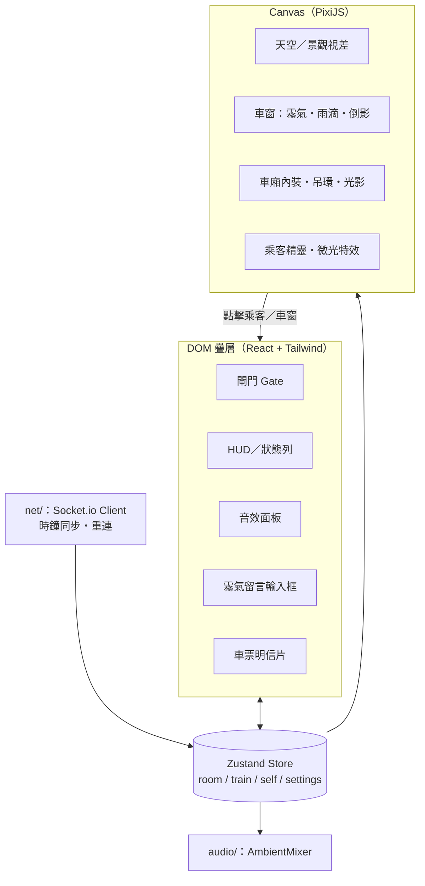

**資料流原則**：網路事件只寫入 store；Pixi 場景、音訊、React 各自訂閱需要的切片。Pixi **不經 React 重繪**，避免 60 fps 下的 reconciliation 成本。

### 6.4 渲染細節

**像素完美（Pixel-Perfect）設定**

- 全域貼圖取樣設為 Nearest（Pixi v8：`TextureStyle.defaultOptions.scaleMode = 'nearest'`），Application 啟用 `roundPixels`。
- 整個場景先畫進一張 **640 × 360（直式 360 × 640）的 RenderTexture**，最後一步才以整數倍率放大到螢幕；畫布 CSS 加上 `image-rendering: pixelated`。
- 倍率以**實體像素**計算：`scale = floor(min(cssW × dpr / 640, cssH × dpr / 360))`，視窗尺寸改變或螢幕旋轉時重新計算。
- 文字一律在 DOM 層呈現（像素字型＋ `font-smooth` 關閉），不在 canvas 內縮放文字。

**場景與動態**

- **視差**：遠景用 `TilingSprite`，位移量 = 列車速度 × 層級係數，**每層位移取整數像素**；列車速度由列車時鐘的進度曲線（加速 → 巡航 → 減速）推導。
- **角色動畫**：`AnimatedSprite` 以每幀 400～800 ms 播放；各乘客加上隨機起始相位，避免全車同步呼吸。Palette Swap 以一個共用 Filter 依 uniform 換色。
- **光照緩衝區**：以 320 × 180 的 RenderTexture 繪製光柱、霓虹窗形光斑、隧道掃光與微光，再放大 2 倍與場景合成（晨間加算、夜間先乘算環境色再加算光）。
- **像素化 Bloom**：光照緩衝區 → 降採樣 → 模糊 → **量化成 4 個亮度階** → 加算回場景；量化步驟讓光暈保持像素階梯感。
- **霓虹窗形光斑**：夜間窗外每經過一個霓虹招牌，就在光照緩衝區畫一個「窗框形狀」的色塊，沿地板與座椅以近景視差速度平移，邊緣 2 階抖色。
- **雨與水珠**：窗外雨絲用 `ParticleContainer`（傾斜角 ∝ 列車速度）；玻璃水珠每扇窗一個小型模擬（附著 → 累積 → 滑落 → 合併），滑落軌跡寫入水痕 RenderTexture 後逐步淡出。
- **霧氣**：每扇窗一張霧貼圖＋雜訊位移 Filter；留言文字繪入 RenderTexture 當反向遮罩（或使用 erase 混合模式）；Filter 以雜訊門檻做「重新起霧」。
- **吊環**：以列車加速度驅動的阻尼彈簧，到站時一起前傾——這是最便宜也最有「真實感」的細節。
- **隧道燈**：閃爍頻率鎖在 3 Hz 以下；「減少動態」開啟時改為柔和明暗漸變。
- **品質分級**：依前 5 秒平均 fps 自動選擇「高／中／低」——低階關閉水珠模擬與 Bloom、雨絲減半，美術風格不變。

### 6.5 效能與電量預算

陪伴型產品會被開著好幾個小時，**電量就是留存**。

**「毫秒級」載入策略**：網路首次下載無法真正做到毫秒級，因此把體感切成三段，讓每一段都快到感覺不到等待：

1. **閘門畫面不等 JS**：閘門的 HTML、CSS 與 TPRT 標誌（內嵌 SVG／小 PNG）直接寫在 `index.html`，首個回應 < 14 KB，一次往返即可繪製。
2. **在玩家做選擇時預載**：選路線、選卡面的幾秒內，背景載入 Pixi、角色 Atlas 與所選路線的景觀 Atlas（`<link rel="preload">`＋動態 import）。
3. **進站轉場即時**：按下感應進站時資源多半已就緒，轉場只剩「車門打開」動畫；提示音即時合成，不需下載。

像素美術天生輕量：640 × 360 解析度的 Atlas 以 WebP 無損壓縮，單張通常只有數十至數百 KB。

| 情境 | 目標 |
|---|---|
| `index.html`（含閘門畫面） | < 14 KB，4G 下首次繪製 < 1 秒 |
| 首屏 JS（gzip） | < 250 KB |
| 角色 Atlas＋單一路線景觀 Atlas | 合計 < 600 KB |
| 進站前總傳輸（含鐵軌音檔） | < 1.5 MB |
| 按下進站 → 車廂畫面（資源已預載） | < 300 ms |
| 一般狀態 | 60 fps |
| 😴 補眠狀態／閒置 2 分鐘 | 降為 15～30 fps |
| 分頁隱藏 | **停止渲染、保留音訊**（使用者常在其他分頁工作時聽白噪音） |
| 記憶體 | 行動裝置 < 150 MB |

### 6.6 專案目錄結構（pnpm monorepo）

```
carriage-corner/
├─ apps/
│  ├─ web/                    # 前端
│  │  ├─ src/
│  │  │  ├─ game/             # PixiJS：scenes/ layers/ sprites/ filters/
│  │  │  ├─ ui/               # React 元件：Gate, HUD, Mixer, NoteComposer, TicketModal
│  │  │  ├─ audio/            # AmbientMixer、synth/（合成提示音）、announce/（廣播濾鏡）
│  │  │  ├─ net/              # socket 封裝、時鐘同步、重連
│  │  │  ├─ store/            # Zustand slices
│  │  │  └─ ticket/           # 車票明信片繪製與分享
│  │  └─ public/
│  │     ├─ audio/  fonts/  atlas/
├─ art/                       # Aseprite 原始檔、48 色主調色盤 .gpl、TPRT 標誌、隨行卡卡面
├─ assets/LICENSES.md         # 外部素材授權登記表（CI 檢查）
│  └─ server/                 # 即時層＋ HTTP API
│     └─ src/
│        ├─ rooms/            # Room, RoomManager, TrainClock, NpcDirector
│        ├─ moderation/       # 文字過濾、檢舉、靜音
│        ├─ http/             # /api/board, /api/ticket, /og
│        └─ index.ts
└─ packages/
   └─ shared/                 # 協定型別、Zod schema、站點資料、語錄池
```

---

## 7. 後端與即時連線設計

### 7.1 系統架構

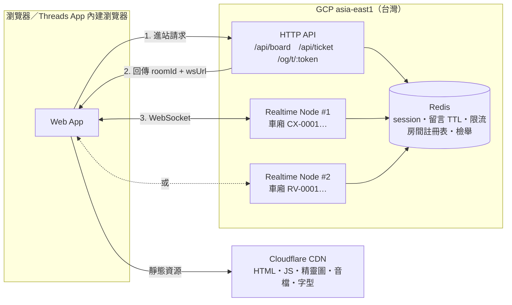

> MVP 階段 API 與 Realtime 可以是**同一個 Node 程序**，`wsUrl` 永遠指向自己；架構先預留分片介面即可。

### 7.2 設計原則

1. **伺服器權威**：座位、時間戳、限流、TTL、到站時刻一律由伺服器決定。
2. **低頻、事件驅動**：沒有每秒同步的位置資料。每位玩家平均入站流量 < 0.05 則／秒。
3. **快照＋增量**：進站時拿完整快照，之後只收增量事件。
4. **用戶端可推導的就不傳**：列車進度、景觀、光影都由「列車時鐘＋本機時間」在用戶端計算。

### 7.3 列車時鐘（Train Clock）

伺服器只廣播「這段旅程從哪裡、到哪裡、何時出發、何時抵達、屬於哪種區段」，用戶端自行插值：

```
progress = clamp((now + clockOffset - departAt) / (arriveAt - departAt), 0, 1)
```

- `clockOffset`：進站快照的 `serverTime` 搭配 ping 往返時間估算，每 5 分鐘校正一次。
- 依 `progress` 推導速度曲線 → 視差速度、吊環擺動、到站減速。
- 依 `segment` 決定景觀層與鐵軌音效版本；`portal_up／portal_down` 在區段中段觸發出入隧道轉場。

### 7.4 車廂房間動態分流（Room Management）

**分流演算法**（三段式，兼顧「不冷清」與「低密度」）：

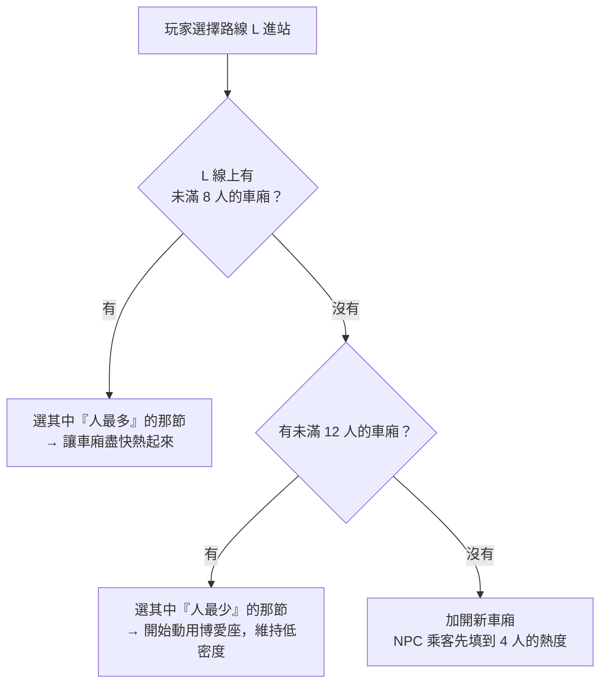

**座位挑選（台北式就座）**：

1. 先排除博愛座（`1A／6A／1B／6B`），除非一般座已滿。
2. 在剩餘座位中，選「與已就座者**同排最短距離最大**」的位子——也就是**盡量隔一個位子坐**；對面長椅不算「坐旁邊」。
3. 同分時隨機，避免所有人都擠在同一側。

**NPC 乘客（車廂常客）**：

- 新車廂真人 < 4 時，由 `NpcDirector` 補 NPC 至 4 人熱度；真人進來時 NPC 在下一站「下車」讓位。
- NPC 會換狀態、會上下車，偶爾有 NPC 阿嬤坐在博愛座（彩蛋）。
- **誠實原則**：NPC 以略淡的色調區分、**絕不主動對玩家送微光**（避免假溫暖）、不計入車票上的「同車人數」。

**房間生命週期**：

| 事件 | 處理 |
|---|---|
| 建立 | 指派 `roomId`（如 `CX-0042`）、隨機起站與方向、啟動列車時鐘 |
| 玩家斷線 | 標記 `awaySince`，座位保留；他人看到其變為 😴 |
| 到站 | 離線超過 60 秒者下車；NPC 依熱度增減 |
| 連續 3 站無真人 | 停止時鐘、釋放房間 |
| （Future）稀疏併車 | 真人 < 3 持續 2 站時，到站時整車經貫通道併入隔壁車廂 |

> Node.js 單執行緒：「挑房間 → 挑座位 → 寫入」在同一個同步區段完成，天然避免搶座競態。跨節點時由 `/api/board` 透過 Redis 的房間註冊表決定節點，但**座位仍由擁有該房間的節點指派**。

### 7.5 事件協定總覽

**Client → Server**（皆使用 Socket.io acknowledgement 回傳 `{ ok, code? }`）

| 事件 | Payload 重點 | 限流 |
|---|---|---|
| `board` | `sid, resumeToken?, line, avatar` | 每 sid 每分鐘 5 次 |
| `state:set` | `state` | 每 5 秒 1 次 |
| `glow:send` | `to, kind` | 10／分；同對象 1／2 分 |
| `note:write` | `text` | 1／站；3／10 分 |
| `note:report` | `nid` | 10／小時 |
| `pref:set` | `dnd` | 每 5 秒 1 次 |
| `clock:sync` | `t0`（ack 回傳伺服器時間，用於時鐘校正） | 每分鐘 2 次 |

**Server → Client**

| 事件 | 說明 |
|---|---|
| `pax:join` | 新乘客（`via: gangway \| door`） |
| `pax:leave` | 乘客離開（`reason: station \| transfer`） |
| `pax:state` | 狀態變更 |
| `glow` | 微光（**不含送出者**） |
| `note:new` ／ `note:gone` | 霧氣留言出現／被管理移除（自然消散由用戶端依 `expiresAt` 處理） |
| `train:arrive` ／ `train:depart` | 到站（含下車名單、NPC 增減）／發車（含下一段列車快照） |
| `notice` | 系統訊息（維護、留言暫停等） |

> **實作補充（M2）**：`TrainSnapshot` 增加 `dwellMs`（停站毫秒數，用戶端據此排程關門警示音）；`note:write` 的 ack 回傳 `{ nid }`；新增 ack code `CARE`（留言含自傷字詞時不廣播，改在本人畫面顯示求助資源）。被過濾的留言不計入「每 10 分鐘 3 則」額度，另以「每 10 分鐘 10 次嘗試」限流。

### 7.6 斷線重連

- Socket.io 僅使用 `websocket` transport（省去 long-polling 升級與 sticky session 需求）。
- 行動版 Safari 切到背景常會斷線：`visibilitychange` 回到前景時立即重連並帶 `resumeToken`。
- `resumeToken` = HMAC 簽章的 `{ sid, pid, roomId, seat, exp }`，有效期 10 分鐘；伺服器驗證後若座位仍保留即復位，否則重新分流。

### 7.7 安全與內容治理

**霧氣留言過濾流程**

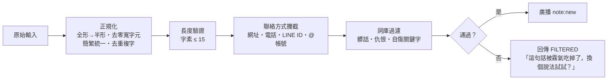

| 機制 | 規格 |
|---|---|
| 自傷關鍵字 | 不只是擋下：在**本人畫面**溫柔顯示求助資源（如 1925 安心專線），不對他人廣播 |
| 檢舉 | 同一則被 3 個不同 sid 檢舉 → 全車隱藏；作者 sid 進入 24 小時「影子靜音」（本人看得到自己的留言，他人看不到） |
| 限流 | 記憶體 token bucket（每連線）＋ Redis 計數（跨重連） |
| 輸入驗證 | 所有 C→S payload 經 Zod 驗證，不合格直接丟棄 |
| 總開關 | 後台一鍵關閉全站留言（突發狀況時） |
| 個資 | 不收集姓名、Email、精確位置；IP 僅用於限流且不落地保存 |

### 7.8 擴展路線

| 階段 | 規模 | 做法 |
|---|---|---|
| P0 | ≤ 3k CCU | 單一 Node 程序（2 vCPU）；房間在記憶體、Redis 存 session／留言／限流 |
| P1 | ≤ 30k CCU | 多個 Realtime 節點；**以房間分片**（一個房間只活在一個節點），`/api/board` 依 Redis 註冊表選節點並回傳 `wsUrl`；不需要跨節點廣播 |
| P2 | 爆紅尖峰 | 自動擴展節點、新房間優先分配至低負載節點；靜態資源全走 CDN |

> 粗估：10k CCU ≈ 每秒 500 則入站、約 6k 則扇出（每節車廂 ≤ 12 人），對 Node 而言負載很輕；瓶頸會在連線數與記憶體，而非 CPU。上線前以 k6 或 Artillery 做 10k 連線壓測。

### 7.9 Redis 資料結構

| Key | 型別 | 內容 | TTL |
|---|---|---|---|
| `sess:{sid}` | Hash | `pid, roomId, seat, avatar, lastSeen` | 10 分 |
| `rooms:{line}` | Sorted Set | `roomId → 真人數` | — |
| `room:{roomId}:node` | String | 擁有節點 | 隨房間 |
| `room:{roomId}:snap` | Hash | 房間快照（節點崩潰復原用） | 15 分 |
| `notes:{roomId}` | Sorted Set | `nid → expiresAt`（內容另存 `note:{nid}`） | 10 分 |
| `rl:{sid}:{action}` | String | 限流計數 | 視規則 |
| `report:{nid}` | Set | 檢舉者 sid | 1 天 |
| `mute:{sid}` | String | 影子靜音 | 24 小時 |

---

## 8. Threads 社群擴散機制

### 8.1 🎫 北城捷運車票明信片

**設計概念**：一張像舊式紙本單程票的明信片，記錄「你今天在這節車廂裡安靜地待了多久」。不是成就、不是分數，是**一段旅程的紀念**。版面為原創設計，不仿照任何真實票證樣式（見第 3 章）。

```
┌──────────────────────────────────────┐
│██ CX 城心線 ███████████████████[T]TPRT│  ← 路線色帶＋原創 T 字標誌
│  北城捷運  單程票      ONE-WAY TICKET  │
│                                      │
│    中央站     ───▶   展覽館            │
│    Central         Expo Hall          │
│                                      │
│    隨行卡  [🧋珍奶]                    │  ← 玩家選的卡面
│                                      │
│    座位  3B          2026.11.03（二）  │
│    乘車  21:02 → 21:49（47 分）        │
│    🌃 夜間班次                         │
│ ─ ─ ─ ─ ─ ─ ─ ─ ─ ─ ─ ─ ─ ─ ─ ─ ─ ─ ─ │  ← 撕線
│    📖 專注 ×2    ☕ ×3    👏 ×1         │
│    和 7 位陌生人安靜地同行了一段路      │
│                                      │
│ 「在這節車廂裡，沉默也是一種問候。」      │
│                                      │
│  No. CX0042-3B-1103-2149        ▣ QR  │
│  車廂角落・免下載，現在就上車           │
└──────────────────────────────────────┘
```

| 規格 | 內容 |
|---|---|
| 尺寸 | **1080 × 1350（4:5）**——Threads 動態牆直式圖片的甜蜜點；另提供 1080 × 1920 限動版（Future） |
| 內容 | 虛構路線、虛擬起訖站、座位、隨行卡卡面、日期、上下車時間與時長、時段、本機統計（專注模式、收到的四種互動與幸運籤，§17.3）、同車真人數、隨機溫暖語錄、序號、QR Code |
| 可選 | 加上自己今天寫過的霧氣留言（**僅在本機圖片**，不進入公開連結） |
| 風格 | 像素風票面＋莫蘭迪色：晨間版燕麥紙感 `#E8E1D5`；夜間版煙紫 `#3A3846`＋暖燈黃字 |
| 法律 | 只使用北城捷運 TPRT 標誌與虛構名稱；地標僅以剪影出現，不標示真實名稱 |
| 生成 | **全在用戶端**以 Canvas 2D 繪製（零伺服器成本），繪製前 `document.fonts.load()` 確保像素字型就緒 |

### 8.2 分享流程

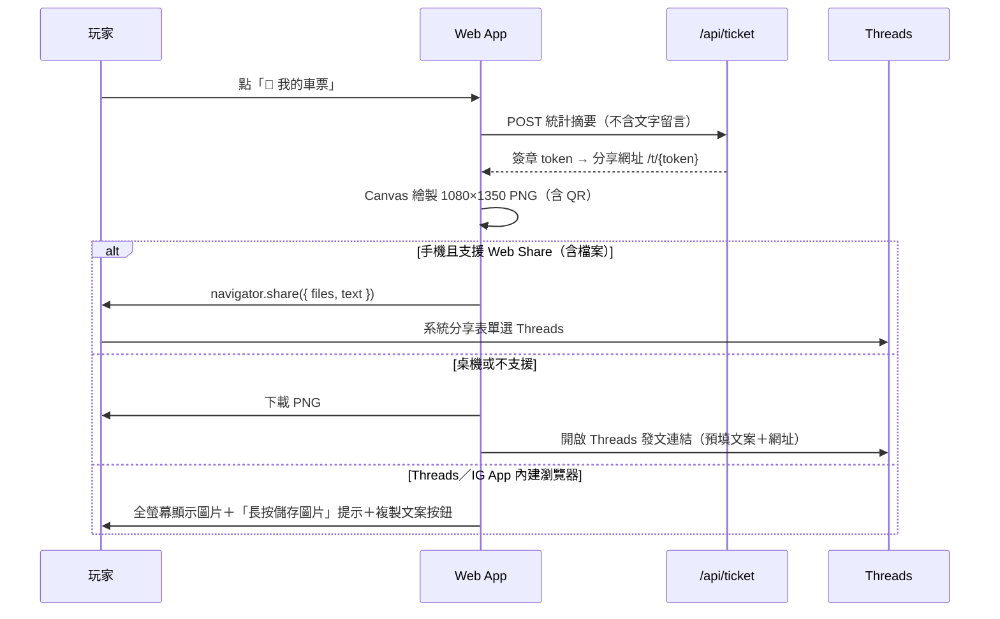

> ⚠️ **大部分流量會從 Threads App 內建瀏覽器進來**，該環境常不支援檔案分享與下載。「長按存圖」退路是 MVP 必做，不是加分項。

### 8.3 無狀態分享連結與 OG 預覽

- `/api/ticket` 回傳 `token = base64url(payload) + "." + HMAC(payload)`，payload 只含路線、站碼、座位、時間、統計數字與語錄 ID——**不含任何使用者輸入文字**，因此公開連結不需要內容審核，也不需要資料庫。
- `GET /og/t/{token}.png` 在伺服器端渲染 1200×630 OG 圖，CDN 快取。Threads 貼上連結時就會顯示這張車票卡片。
  - **實作（M3）**：改用自製像素畫布＋原創 5×7 點陣字（英文站名、數字）直接編碼 PNG，取代 Satori＋resvg：伺服器不需要載入數 MB 的中文字型檔，風格也與像素美術一致。中文內容放在落地頁與用戶端產生的明信片上。
  - token 以精簡陣列編碼（約 110 字元），payload 只含代碼與數字。
- 點擊 `/t/{token}` → 落地頁顯示這張車票＋「搭上同一條線」按鈕（預選該路線進閘門）。

### 8.4 其他擴散鉤子

| 鉤子 | 說明 |
|---|---|
| 🎆 跨年高塔煙火班次 | 12/31 23:30 起雲橋線高架段看「城市之塔」煙火，車票換成跨年特別版——上線檔期的第一個爆點（對外文案不使用真實地標名稱） |
| 🌇 河口夕照時刻 | 河岸線在日落前後 15 分鐘出現夕照景，車票加上夕陽印章 |
| 🎴 隨行卡卡面 | 卡面印在車票上，成為分享時的個人化元素；季節限定卡面（Future）帶動回訪 |
| 🌀 颱風天班次（Future） | 颱風假當天全線雨聲＋特別語錄，「大家一起在家搭車」 |
| 💬 每日車廂語錄 | 官方 Threads 帳號每天一則語錄，與遊戲內語錄池同步 |
| 🔗 搭同一班車（Future） | 深連結 `?line=RV&with={roomHint}`，若該車廂未滿則盡量分到同一節，但**車廂內仍彼此匿名** |
| 🏷 話題標籤 | 預填文案帶 `#車廂角落`（Threads 每則貼文一個主題標籤） |

### 8.5 分享文案模板

```
我在《車廂角落》城心線 3B 安靜地坐了 47 分鐘 ☕×3
「在這節車廂裡，沉默也是一種問候。」
你也上車吧 → {shareUrl} #車廂角落
```

語錄池見 [附錄 B](#b-溫暖語錄池初版)。

---

## 9. 程式碼範例

### 9.1 WebSocket 事件 JSON 範例

以 Socket.io 為例，事件名稱即 `type`，以下為 payload。若改用原生 WebSocket，請包成信封格式 `{ "v": 1, "t": "<事件名>", "d": { ...payload } }`。

**① C→S `board`：感應隨行卡進站**

```json
{
  "sid": "anon_7f3k9q2m",
  "resumeToken": null,
  "line": "CX",
  "avatar": "commuter_02",
  "passCard": "boba"
}
```

**② ack：進站快照**

```json
{
  "ok": true,
  "data": {
    "serverTime": 1793690520000,
    "resumeToken": "eyJzaWQiOiJhbm9uXzdmM2s5cTJtIi...Q.8f2c1a",
    "room": { "id": "CX-0042", "line": "CX", "capacity": 12 },
    "you": { "pid": "p_9a2x", "seat": "3B", "codename": "Seat 3B" },
    "train": {
      "dir": "toward:CX07",
      "from": "CX03",
      "to": "CX04",
      "departAt": 1793690400000,
      "arriveAt": 1793690820000,
      "segment": "underground"
    },
    "passengers": [
      { "pid": "p_1c4f", "seat": "2A", "avatar": "student_01", "state": "read",  "since": 1793689900000 },
      { "pid": "p_77qe", "seat": "4A", "avatar": "hoodie_03",  "state": "sleep", "since": 1793688000000 },
      { "pid": "npc_04", "seat": "5A", "avatar": "office_02",  "state": "read",  "since": 1793690100000, "npc": true }
    ],
    "notes": [
      { "nid": "n_88kd", "window": 2, "text": "今天也要好好吃飯", "mode": "night",
        "createdAt": 1793690300000, "expiresAt": 1793690780000 }
    ]
  }
}
```

**③ S→C `pax:join`：有人從隔壁車廂走過來**

```json
{ "pid": "p_k2m8", "seat": "5B", "avatar": "headphone_01", "state": "idle", "since": 1793690531000, "via": "gangway" }
```

**④ C→S `state:set` ➜ S→C `pax:state`**

```json
{ "state": "read" }
```

```json
{ "pid": "p_9a2x", "state": "read", "since": 1793690540000 }
```

**⑤ C→S `glow:send` ➜ S→C `glow`（注意：廣播中沒有送出者）**

```json
{ "to": "p_1c4f", "kind": "nod" }
```

```json
{ "to": "p_1c4f", "kind": "nod", "at": 1793690552000 }
```

**⑥ C→S `note:write` ➜ 成功廣播 `note:new`／失敗 ack**

```json
{ "text": "今天我要把報告寫完" }
```

```json
{ "nid": "n_91zp", "window": 3, "text": "今天我要把報告寫完", "mode": "morning",
  "createdAt": 1793690560000, "expiresAt": 1793691040000 }
```

```json
{ "ok": false, "code": "FILTERED" }
```

**⑦ S→C `train:arrive` ➜ `train:depart`**

```json
{
  "station": "CX04",
  "doorsOpenMs": 20000,
  "leaving": ["p_77qe"],
  "npc": { "leave": ["npc_04"], "board": [] }
}
```

```json
{
  "train": {
    "dir": "toward:CX07",
    "from": "CX04",
    "to": "CX05",
    "departAt": 1793690840000,
    "arriveAt": 1793691320000,
    "segment": "underground"
  }
}
```

**⑧ 錯誤碼一覽**

| code | 意義 | UI 文案 |
|---|---|---|
| `BAD_REQUEST` | payload 驗證失敗 | （靜默，記錄 log） |
| `RATE_LIMITED` | 超過頻率 | 「車窗還很濕，等下一站再寫吧。」 |
| `FILTERED` | 留言未通過過濾 | 「這句話被霧氣吃掉了，換個說法試試？」 |
| `NO_TARGET` | 對象已下車 | （靜默） |
| `NOTES_PAUSED` | 留言總開關關閉 | 「車窗正在清潔中，晚點再來寫。」 |

### 9.2 共用型別（`packages/shared/src/protocol.ts`）

```ts
export type LineId = 'CX' | 'RV' | 'SK';               // 北城捷運虛構路線：城心線／河岸線／雲橋線
export type PassCardId = 'tile' | 'boba' | 'ricecooker' | 'mangoice'; // 隨行卡卡面
export type Bench = 'A' | 'B';
export type SeatId = `${1 | 2 | 3 | 4 | 5 | 6}${Bench}`;
export type PaxState = 'idle' | 'music' | 'read' | 'sleep'; // v1.2 移除 coffee（禁止飲食）
export type GlowKind = 'nod' | 'light' | 'pat';
export type Segment = 'underground' | 'elevated' | 'portal_up' | 'portal_down';
export type Mode = 'morning' | 'night';

export interface Passenger {
  pid: string;
  seat: SeatId;
  avatar: string;
  state: PaxState;
  since: number;
  npc?: true;
}

export interface TrainSnapshot {
  dir: string;
  from: string;
  to: string;
  departAt: number;
  arriveAt: number;
  segment: Segment;
}

export interface WindowNote {
  nid: string;
  window: number;
  text: string;
  mode: Mode;
  createdAt: number;
  expiresAt: number;
}

export type Ack<T = undefined> =
  | ({ ok: true } & (T extends undefined ? {} : { data: T }))
  | { ok: false; code: 'BAD_REQUEST' | 'RATE_LIMITED' | 'FILTERED' | 'NO_TARGET' | 'NOTES_PAUSED' };

export interface ClientToServer {
  board: (req: { sid: string; resumeToken: string | null; line: LineId; avatar: string; passCard: PassCardId },
          ack: (res: Ack<BoardedSnapshot>) => void) => void;
  'state:set': (req: { state: PaxState }, ack: (res: Ack) => void) => void;
  'glow:send': (req: { to: string; kind: GlowKind }, ack: (res: Ack) => void) => void;
  'note:write': (req: { text: string }, ack: (res: Ack) => void) => void;
  'note:report': (req: { nid: string }, ack: (res: Ack) => void) => void;
  'pref:set': (req: { dnd: boolean }, ack: (res: Ack) => void) => void;
  'clock:sync': (t0: number, ack: (serverTime: number) => void) => void;
}

export interface ServerToClient {
  'pax:join': (p: Passenger & { via: 'gangway' | 'door' }) => void;
  'pax:leave': (p: { pid: string; reason: 'station' | 'transfer' }) => void;
  'pax:state': (p: { pid: string; state: PaxState; since: number }) => void;
  glow: (g: { to: string; kind: GlowKind; at: number }) => void;
  'note:new': (n: WindowNote) => void;
  'note:gone': (n: { nid: string }) => void;
  'train:arrive': (e: { station: string; doorsOpenMs: number; leaving: string[];
                        npc: { leave: string[]; board: Passenger[] } }) => void;
  'train:depart': (e: { train: TrainSnapshot }) => void;
  notice: (n: { kind: 'maintenance' | 'notes_paused'; message: string }) => void;
}

export interface BoardedSnapshot {
  serverTime: number;
  resumeToken: string;
  room: { id: string; line: LineId; capacity: number };
  you: { pid: string; seat: SeatId; codename: string };
  train: TrainSnapshot;
  passengers: Passenger[];
  notes: WindowNote[];
}
```

### 9.3 後端：房間分流與座位挑選（`apps/server/src/rooms/RoomManager.ts`）

```ts
import type { LineId, Passenger, SeatId } from '@cc/shared';
import { Room } from './Room';

const SOFT_CAP = 8;   // 一般座數量＝理想密度
const HARD_CAP = 12;  // 含博愛座的絕對上限
const PRIORITY_SEATS = new Set<SeatId>(['1A', '6A', '1B', '6B']);
const ALL_SEATS: SeatId[] = [1, 2, 3, 4, 5, 6].flatMap(n => [`${n}A`, `${n}B`] as SeatId[]);

export class RoomManager {
  private rooms = new Map<string, Room>();

  /** 三段式分流：先求不冷清，再求低密度，最後才加開車廂 */
  assign(line: LineId): Room {
    const rooms = [...this.rooms.values()].filter(r => r.line === line);

    // ① 未達 8 人的車廂中，挑人最多的 → 讓車廂盡快熱起來
    const cozy = rooms.filter(r => r.realCount < SOFT_CAP).sort((a, b) => b.realCount - a.realCount)[0];
    if (cozy) return cozy;

    // ② 都已達 8 人：挑人最少的未滿車廂 → 開始動用博愛座
    const roomy = rooms.filter(r => r.realCount < HARD_CAP).sort((a, b) => a.realCount - b.realCount)[0];
    if (roomy) return roomy;

    // ③ 全部滿載 → 加開新車廂（Room 建構時由 NpcDirector 補到 4 人熱度）
    const room = new Room(line, () => this.rooms.delete(room.id));
    this.rooms.set(room.id, room);
    return room;
  }

  get(roomId: string) {
    return this.rooms.get(roomId);
  }
}

/** 台北式就座：避開博愛座，並盡量和別人隔一個位子 */
export function pickSeat(occupied: Passenger[]): SeatId | null {
  const taken = new Set(occupied.map(p => p.seat));
  const free = ALL_SEATS.filter(s => !taken.has(s));
  if (free.length === 0) return null;

  const regular = free.filter(s => !PRIORITY_SEATS.has(s));
  const pool = regular.length > 0 ? regular : free;

  const score = (s: SeatId) =>
    Math.min(Infinity, ...[...taken].map(t => seatDistance(s, t)));
  const best = Math.max(...pool.map(score));
  const candidates = pool.filter(s => score(s) === best);
  return candidates[Math.floor(Math.random() * candidates.length)];
}

function seatDistance(a: SeatId, b: SeatId): number {
  if (a[1] !== b[1]) return 3; // 對面長椅不算「坐旁邊」
  return Math.abs(Number(a[0]) - Number(b[0]));
}
```

**Socket 事件處理（節錄，`apps/server/src/index.ts`）**

```ts
import { Server } from 'socket.io';
import type { ClientToServer, ServerToClient } from '@cc/shared';
import { BoardReq, GlowReq, NoteReq } from '@cc/shared/schemas';

const io = new Server<ClientToServer, ServerToClient, {}, { pid: string; roomId: string }>(httpServer, {
  transports: ['websocket'],
  perMessageDeflate: false, // 訊息都很小，壓縮反而浪費 CPU
  cors: { origin: process.env.WEB_ORIGIN },
});

io.on('connection', socket => {
  socket.on('board', async (raw, ack) => {
    const req = BoardReq.safeParse(raw);
    if (!req.success) return ack({ ok: false, code: 'BAD_REQUEST' });
    if (!(await limiter.take(`board:${req.data.sid}`, 5, 60_000))) return ack({ ok: false, code: 'RATE_LIMITED' });

    const resumed = await sessions.resume(req.data.resumeToken); // 座位還保留就復位
    const room = resumed?.room ?? rooms.assign(req.data.line);
    const pax = resumed?.pax ?? room.seatNew(req.data.avatar); // 內部呼叫 pickSeat()

    socket.data = { pid: pax.pid, roomId: room.id };
    await socket.join(room.id);
    if (!resumed) socket.to(room.id).emit('pax:join', { ...pax, via: 'gangway' });
    ack({ ok: true, data: room.snapshotFor(pax, sessions.issue(pax, room)) });
  });

  socket.on('glow:send', async (raw, ack) => {
    const req = GlowReq.safeParse(raw);
    if (!req.success || !socket.data.pid) return ack({ ok: false, code: 'BAD_REQUEST' });
    const { pid, roomId } = socket.data;

    const allowed =
      (await limiter.take(`glow:${pid}`, 10, 60_000)) &&
      (await limiter.take(`glow:${pid}>${req.data.to}`, 1, 120_000));
    if (!allowed) return ack({ ok: false, code: 'RATE_LIMITED' });

    const target = rooms.get(roomId)?.pax.get(req.data.to);
    if (!target || target.pid === pid) return ack({ ok: false, code: 'NO_TARGET' });

    // 廣播不帶 from：全車只知道「有人」送出了溫暖
    if (!target.dnd) io.to(roomId).emit('glow', { to: target.pid, kind: req.data.kind, at: Date.now() });
    ack({ ok: true }); // 對方開勿擾時仍回成功，送出者不會感覺被拒絕
  });

  socket.on('note:write', async (raw, ack) => {
    const req = NoteReq.safeParse(raw);
    if (!req.success || !socket.data.pid) return ack({ ok: false, code: 'BAD_REQUEST' });
    const room = rooms.get(socket.data.roomId);
    if (!room) return ack({ ok: false, code: 'BAD_REQUEST' });
    if (moderation.notesPaused) return ack({ ok: false, code: 'NOTES_PAUSED' });
    if (!room.canWriteNote(socket.data.pid)) return ack({ ok: false, code: 'RATE_LIMITED' });

    const verdict = moderation.check(req.data.text);
    if (!verdict.ok) return ack({ ok: false, code: 'FILTERED' });

    const note = room.addNote(socket.data.pid, verdict.text);
    if (await moderation.isShadowMuted(socket.data.pid)) socket.emit('note:new', note);
    else io.to(room.id).emit('note:new', note);
    ack({ ok: true });
  });

  socket.on('clock:sync', (_t0, ack) => ack(Date.now()));

  socket.on('disconnect', () => {
    // 不立刻移除：保留座位，到站時若已離線超過 60 秒才「下車」
    rooms.get(socket.data.roomId)?.markAway(socket.data.pid);
  });
});
```

### 9.4 前端：背景音效／ASMR 載入、即時合成與混音（`apps/web/src/audio/AmbientMixer.ts`）

設計重點：

1. **自動播放政策**：音訊只能在使用者手勢中啟動 → 把「感應隨行卡進站」按鈕當作解鎖時機，世界觀與技術需求合而為一。
2. **原生 Web Audio 音訊圖**：每個頻道一條 Bus，**只有鐵軌聲經過低通濾鏡**、只有廣播經過喇叭濾鏡，互不干擾。
3. **按需載入**：鐵軌底音在進站時載入；雨聲、Lo-Fi 第一次打開才下載。關閉頻道只把音量降為 0，來回切換不必重新解碼。
4. **提示音零下載**：關門警示音（800 Hz ⇄ 1000 Hz）與進站聲全部由 `OscillatorNode` 即時合成。
5. **Ducking**：廣播與警示音播放時，Lo-Fi 暫時壓低。

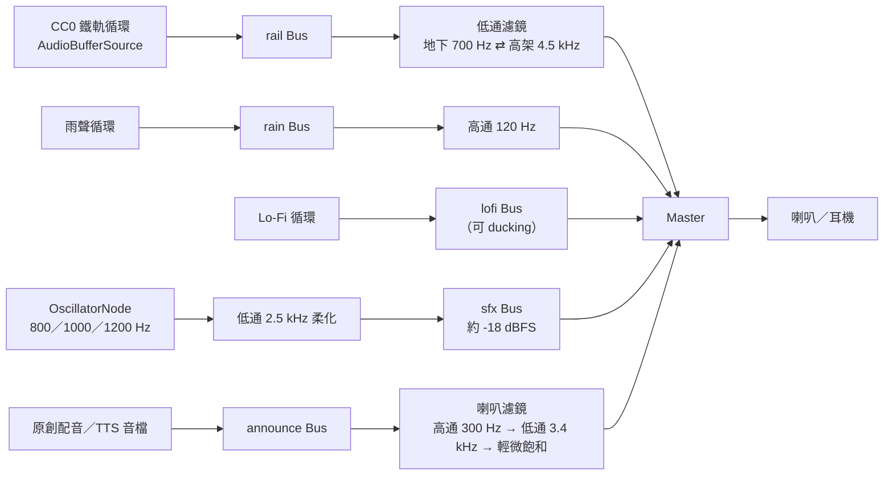

```ts
import type { Segment } from '@cc/shared';

type Channel = 'rail' | 'rain' | 'lofi'; // 使用者看到的三個推桿

// 素材來源與授權逐檔登記於 assets/LICENSES.md
const LOOPS: Record<Channel, { base: string; gain: number }> = {
  rail: { base: '/audio/rail_cc0_loop', gain: 0.6 },  // CC0 鐵道行駛錄音
  rain: { base: '/audio/rain_window', gain: 0.45 },
  lofi: { base: '/audio/lofi_piano', gain: 0.35 },    // 委託原創
};

// 鐵軌聲低通截止頻率：地下悶、高架亮——同一段素材演繹兩種空間
const RAIL_CUTOFF = { underground: 700, elevated: 4500 } as const;

const SFX_GAIN = 0.126; // ≈ -18 dBFS
const STORAGE_KEY = 'cc.mixer.v2';

export class AmbientMixer {
  private ctx: AudioContext | null = null;
  private buses = {} as Record<Channel | 'sfx' | 'announce', GainNode>;
  private master!: GainNode;
  private railFilter!: BiquadFilterNode;
  private sfxTone!: BiquadFilterNode;
  private sources = new Map<Channel, AudioBufferSourceNode>();
  private buffers = new Map<string, Promise<AudioBuffer>>();
  private on: Record<Channel, boolean> = { rail: true, rain: false, lofi: false };
  private level: Record<Channel, number> = { rail: 1, rain: 0.8, lofi: 0.8 };
  private segment: keyof typeof RAIL_CUTOFF = 'underground';
  private ducked = false;
  private duckTimer?: ReturnType<typeof setTimeout>;

  constructor() {
    this.restore();
  }

  /** ⚠️ 必須在使用者手勢（感應進站按鈕的 onClick）中呼叫，否則瀏覽器會擋下自動播放 */
  async unlock(): Promise<void> {
    // iOS Safari 16.4+：讓 Web Audio 在靜音開關打開時仍能出聲
    const session = (navigator as Navigator & { audioSession?: { type: string } }).audioSession;
    if (session) session.type = 'playback';

    if (!this.ctx) this.buildGraph();
    this.playGateBeep(); // 「嗶」——同步排程，落在手勢期間內
    await this.resumeIfNeeded();
    await Promise.all((Object.keys(LOOPS) as Channel[]).map(ch => this.apply(ch, 2.5)));
  }

  /** iOS 來電、切換 App 後 AudioContext 會被暫停；回到前景時呼叫 */
  async resumeIfNeeded() {
    if (this.ctx && this.ctx.state !== 'running') await this.ctx.resume();
  }

  setChannel(ch: Channel, enabled: boolean) {
    this.on[ch] = enabled;
    this.persist();
    return this.apply(ch);
  }

  setLevel(ch: Channel, value: number) {
    this.level[ch] = Math.min(1, Math.max(0, value));
    this.persist();
    return this.apply(ch, 0.15);
  }

  setMaster(value: number) {
    if (this.ctx) this.ramp(this.master.gain, Math.min(1, Math.max(0, value)), 0.15);
  }

  /** 列車區段改變：只滑動鐵軌聲的低通截止頻率，約 3 秒完成，模擬出入隧道 */
  setSegment(seg: Segment) {
    const next = seg === 'portal_up' ? 'elevated' : seg === 'portal_down' ? 'underground' : seg;
    if (next === this.segment) return;
    this.segment = next;
    if (this.ctx) this.ramp(this.railFilter.frequency, RAIL_CUTOFF[next], 3);
  }

  /** 關門警示音：800 Hz ⇄ 1000 Hz 簡短交替，全程即時合成，不使用任何錄音 */
  playDoorChime(beeps = 8, beepMs = 150, gapMs = 30) {
    if (!this.ctx) return;
    const t0 = this.ctx.currentTime + 0.05;
    for (let i = 0; i < beeps; i++) {
      this.beep(i % 2 === 0 ? 800 : 1000, t0 + (i * (beepMs + gapMs)) / 1000, beepMs / 1000);
    }
    this.duck(beeps * (beepMs + gapMs) + 600);
  }

  playGateBeep() {
    if (this.ctx) this.beep(1200, this.ctx.currentTime + 0.01, 0.09);
  }

  /** 到站廣播：建置時預先渲染的原創配音，經「車廂喇叭」濾鏡播放 */
  async playAnnouncement(stationCode: string) {
    if (!this.ctx) return;
    try {
      const buffer = await this.loadBuffer(`/audio/announce/${stationCode}`);
      const src = new AudioBufferSourceNode(this.ctx, { buffer });
      src.connect(this.buses.announce);
      src.start();
      this.duck(buffer.duration * 1000 + 600);
    } catch (err) {
      console.warn(err); // 廣播不是關鍵功能：失敗就安靜略過（字幕仍會顯示）
    }
  }

  private buildGraph() {
    const ctx = (this.ctx = new AudioContext({ latencyHint: 'playback' }));
    this.master = new GainNode(ctx, { gain: 0.8 });
    this.master.connect(ctx.destination);

    for (const name of ['rail', 'rain', 'lofi', 'sfx', 'announce'] as const) {
      this.buses[name] = new GainNode(ctx, { gain: 0 });
    }

    // 鐵軌：Bus → 低通 → Master（只有鐵軌聲經過這個濾鏡）
    this.railFilter = new BiquadFilterNode(ctx, { type: 'lowpass', frequency: RAIL_CUTOFF[this.segment], Q: 0.7 });
    this.buses.rail.connect(this.railFilter).connect(this.master);

    // 雨聲：去掉低頻轟鳴
    this.buses.rain.connect(new BiquadFilterNode(ctx, { type: 'highpass', frequency: 120 })).connect(this.master);

    this.buses.lofi.connect(this.master);

    // 合成提示音：低通 2.5 kHz 磨圓三角波的稜角
    this.buses.sfx.gain.value = SFX_GAIN;
    this.sfxTone = new BiquadFilterNode(ctx, { type: 'lowpass', frequency: 2500 });
    this.sfxTone.connect(this.buses.sfx).connect(this.master);

    // 廣播：「車廂喇叭」質感
    this.buses.announce.gain.value = 0.9;
    this.buses.announce
      .connect(new BiquadFilterNode(ctx, { type: 'highpass', frequency: 300 }))
      .connect(new BiquadFilterNode(ctx, { type: 'lowpass', frequency: 3400 }))
      .connect(new WaveShaperNode(ctx, { curve: softClip(1.5), oversample: '2x' }))
      .connect(this.master);
  }

  /** 單一短音：5 ms 起音／釋音，避免爆音 */
  private beep(freq: number, at: number, len: number) {
    const ctx = this.ctx!;
    const osc = new OscillatorNode(ctx, { type: 'triangle', frequency: freq });
    const env = new GainNode(ctx, { gain: 0 });
    osc.connect(env).connect(this.sfxTone);
    env.gain.setValueAtTime(0, at);
    env.gain.linearRampToValueAtTime(1, at + 0.005);
    env.gain.setValueAtTime(1, at + len - 0.005);
    env.gain.linearRampToValueAtTime(0, at + len);
    osc.start(at);
    osc.stop(at + len + 0.01);
    osc.onended = () => env.disconnect();
  }

  /** 依目前狀態把頻道推到目標音量；第一次需要出聲時才下載與解碼 */
  private async apply(ch: Channel, rampSec = 1.5) {
    if (!this.ctx) return;
    if (this.target(ch) > 0 && !this.sources.has(ch)) {
      try {
        await this.ensureSource(ch);
      } catch (err) {
        console.warn(err); // 環境音載入失敗不影響其他功能
        return;
      }
    }
    this.ramp(this.buses[ch].gain, this.target(ch), rampSec); // 載入期間設定可能已變，重新計算
  }

  private async ensureSource(ch: Channel) {
    const buffer = await this.loadBuffer(LOOPS[ch].base);
    if (this.sources.has(ch)) return; // 並行呼叫時只啟動一次
    // AudioBufferSourceNode 原生循環是樣本級無縫，不會有 MP3 補靜音的接縫
    const src = new AudioBufferSourceNode(this.ctx!, { buffer, loop: true });
    src.connect(this.buses[ch]);
    src.start();
    this.sources.set(ch, src);
  }

  private target(ch: Channel): number {
    if (!this.on[ch]) return 0;
    const duck = ch === 'lofi' && this.ducked ? 0.4 : 1;
    return LOOPS[ch].gain * this.level[ch] * duck;
  }

  private duck(ms: number) {
    this.ducked = true;
    void this.apply('lofi', 0.3);
    clearTimeout(this.duckTimer);
    this.duckTimer = setTimeout(() => {
      this.ducked = false;
      void this.apply('lofi', 1.2);
    }, ms);
  }

  /** 從「目前的值」平滑過渡到目標（rampSec 內完成約 95%） */
  private ramp(param: AudioParam, value: number, rampSec: number) {
    const t = this.ctx!.currentTime;
    param.cancelScheduledValues(t);
    param.setValueAtTime(param.value, t);
    param.setTargetAtTime(value, t, rampSec / 3);
  }

  private loadBuffer(base: string): Promise<AudioBuffer> {
    const url = base + (canPlayOpus() ? '.webm' : '.m4a');
    let p = this.buffers.get(url);
    if (!p) {
      p = fetch(url)
        .then(res => {
          if (!res.ok) throw new Error(`[audio] ${url} 載入失敗：${res.status}`);
          return res.arrayBuffer();
        })
        .then(data => this.ctx!.decodeAudioData(data));
      p.catch(() => this.buffers.delete(url)); // 失敗允許之後重試
      this.buffers.set(url, p);
    }
    return p;
  }

  private persist() {
    try {
      localStorage.setItem(STORAGE_KEY, JSON.stringify({ on: this.on, level: this.level }));
    } catch {
      /* 無痕模式或儲存被封鎖：不影響播放 */
    }
  }

  private restore() {
    try {
      const saved = JSON.parse(localStorage.getItem(STORAGE_KEY) ?? 'null');
      if (saved) {
        Object.assign(this.on, saved.on);
        Object.assign(this.level, saved.level);
      }
    } catch {
      /* 使用預設值 */
    }
  }
}

// 以 <audio> 的支援度近似判斷 decodeAudioData 能否解 Opus；Safari 需實機驗證，不支援時退回 AAC
const canPlayOpus = () => document.createElement('audio').canPlayType('audio/webm; codecs="opus"') !== '';

/** 輕微飽和失真曲線：讓廣播帶一點老喇叭的顆粒感 */
function softClip(k: number, n = 1024): Float32Array {
  const curve = new Float32Array(n);
  for (let i = 0; i < n; i++) {
    const x = (i / (n - 1)) * 2 - 1;
    curve[i] = Math.tanh(k * x) / Math.tanh(k);
  }
  return curve;
}

export const mixer = new AmbientMixer();
```

**接線方式**

```tsx
// ui/Gate.tsx —— 感應隨行卡進站＝解鎖音訊的使用者手勢
<button
  className="rounded-xl bg-[#E6C9A8] px-8 py-4 font-pixel text-lg text-[#4A4744]"
  onClick={() => {
    void mixer.unlock();
    board(selectedLine, selectedAvatar, selectedPassCard);
  }}
>
  嗶！感應隨行卡進站
</button>
```

```ts
// net/bindAudio.ts —— 音訊只訂閱 store 與事件，不依賴 React
useTrain.subscribe(s => s.train?.segment, seg => seg && mixer.setSegment(seg));

socket.on('train:arrive', e => {
  void mixer.playAnnouncement(e.station);                         // 到站廣播（字幕同步顯示）
  setTimeout(() => mixer.playDoorChime(), e.doorsOpenMs - 2000);  // 關門前 2 秒響起警示音
});

useSelf.subscribe(s => s.state, state => state === 'music' && mixer.setChannel('rain', true));

document.addEventListener('visibilitychange', () => {
  if (document.visibilityState === 'visible') void mixer.resumeIfNeeded();
});
```

> **補充說明**
> - **地下段殘響**：可在鐵軌 Bus 後再並聯一個 `ConvolverNode`（用程式產生的短衰減噪音當 IR，不需外部素材），依區段調整乾濕比；此範例省略。
> - **iOS 鎖屏背景播放**：Web Audio 在 iOS 鎖屏後會暫停。若使用者開啟「鎖屏後繼續播放」，改以 `<audio>` 元素播放一條**預先混好的長循環**（鐵軌＋雨聲，3～5 分鐘），並以 Media Session API 顯示鎖屏控制；此模式下無法即時套用區段濾鏡，屬可接受的取捨。

### 9.5 前端：車票明信片分享（`apps/web/src/ticket/share.ts`）

```ts
export async function shareTicket(ticket: TicketData): Promise<'shared' | 'downloaded' | 'manual' | 'cancelled'> {
  const blob = await renderTicketPng(ticket); // Canvas 2D 繪製 1080×1350
  const file = new File([blob], `carriage-corner-${ticket.serial}.png`, { type: 'image/png' });
  const text =
    `我在《車廂角落》${ticket.lineName} ${ticket.seat} 安靜地坐了 ${ticket.minutes} 分鐘\n` +
    `「${ticket.quote}」\n你也上車吧 → ${ticket.shareUrl} #車廂角落`;

  // Threads／IG App 內建瀏覽器：不保證支援檔案分享與下載 → 顯示圖片讓使用者長按儲存
  if (isInAppBrowser()) {
    showLongPressSaveSheet(blob, text);
    return 'manual';
  }

  if (navigator.canShare?.({ files: [file] })) {
    try {
      await navigator.share({ files: [file], text });
      return 'shared';
    } catch (err) {
      if ((err as DOMException).name === 'AbortError') return 'cancelled';
    }
  }

  // 桌機退路：下載圖片＋開啟 Threads 發文頁（發文連結只能預填文字與網址，圖片需使用者自行附加）
  const url = URL.createObjectURL(blob);
  Object.assign(document.createElement('a'), { href: url, download: file.name }).click();
  setTimeout(() => URL.revokeObjectURL(url), 10_000);
  window.open(`https://www.threads.com/intent/post?text=${encodeURIComponent(text)}`, '_blank', 'noopener');
  return 'downloaded';
}

function isInAppBrowser(): boolean {
  return /Barcelona|Instagram|FBAN|FBAV|Line\//i.test(navigator.userAgent);
}
```

> Threads 發文連結的網域與參數格式請於開發時再次確認；Threads App 的 User-Agent 標記亦需實機驗證後更新判斷式。

---

## 10. 非功能需求

| 類別 | 需求 |
|---|---|
| 🌐 瀏覽器支援 | Chrome／Edge／Firefox／Safari 最新兩版；iOS Safari 16.4+；Android Chrome；**Threads 與 Instagram App 內建瀏覽器（必測）**、LINE 內建瀏覽器 |
| ♿ 無障礙 | 鍵盤可操作（Tab 遍歷乘客、Enter 開啟微光選單）；乘客具 ARIA 標籤（「Seat 2A，正在閱讀」）；到站廣播提供字幕；`prefers-reduced-motion` 時停用閃爍與大幅視差；文字對比 ≥ WCAG AA |
| ⚡ 光敏安全 | 所有閃爍 < 3 Hz，大面積亮度變化需漸變 |
| 🎨 美術一致性 | 所有素材取自 48 色主調色盤；CI 檢查 Atlas 是否出現調色盤外顏色與非整數縮放 |
| ⚖️ 法規與授權 | 第 3 章規範為上線阻擋條件；CI 掃描原始碼、i18n 字串與素材檔名中的禁用名詞（如「悠遊卡」「捷運公司」、真實站名清單）；新增外部素材必須同步登記 `LICENSES.md` |
| 🔒 隱私 | 無帳號、無 Email、無精確定位；分析事件僅含匿名 sid；符合個人資料保護法最小蒐集原則；提供隱私說明頁 |
| 🌏 在地化 | zh-TW 為主、en 為輔；站名雙語；字串集中於 i18n 檔 |
| 📈 可觀測性 | 伺服器：連線數、房間數、事件速率、ack 延遲 p95、記憶體；前端：fps 抽樣、首屏時間、音訊載入失敗率 |
| 🧪 測試 | 協定 schema 單元測試；分流與座位挑選的性質測試；10k 連線壓測；iOS／Android 實機矩陣 |

**匿名分析事件**：`board`、`state_change`、`pomodoro_start／complete`、`note_write／note_reject`、`glow_send`、`ticket_generate`、`ticket_share{method}`、`session_end{duration}`。

---

## 11. 開發里程碑

**建議團隊**：前端遊戲工程 ×1（兼 Shader／粒子）、前端 UI 工程 ×1、後端工程 ×1、像素美術 ×1（熟悉 Aseprite 與現代像素光影）、音效設計（外包，負責 CC0 篩選、授權登記與廣播配音）×1、PM／UX ×1；法務顧問（按件）。

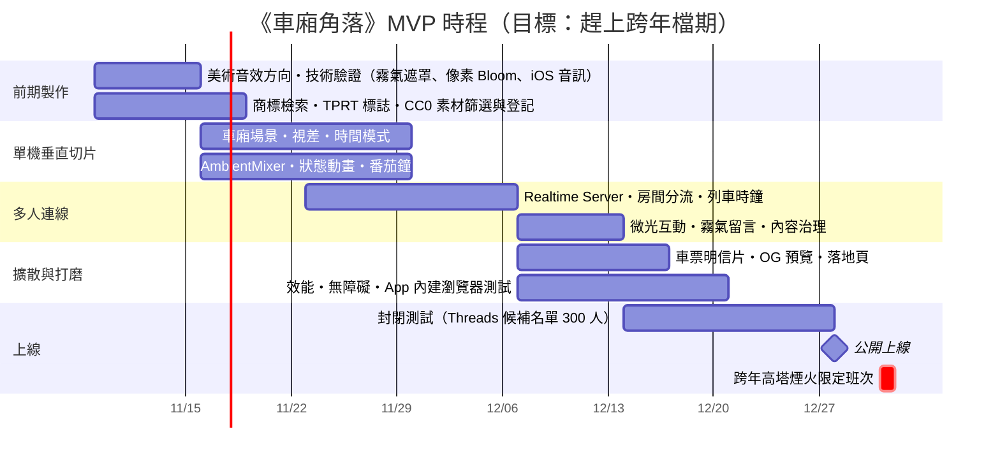

| 里程碑 | 完成定義 |
|---|---|
| M0 技術驗證（11/15） | 霧氣反向遮罩＋像素化 Bloom 在中階手機 60 fps；iOS 上音訊解鎖、無縫循環與合成警示音驗證完成；48 色主調色盤與 1 個角色完整動畫定稿 |
| M0.5 品牌與授權（11/19） | 商標檢索完成、TPRT 標誌與隨行卡卡面定稿、CC0 鐵軌素材登記入 `LICENSES.md` |
| M1 垂直切片（11/29） | 單人可完整體驗一節車廂：景觀、時間模式、光影粒子、音效、狀態、番茄鐘 |
| M2 多人（12/13） | 12 人同車、到站流動、微光、留言＋治理全部可用 |
| M3 封測（12/14–12/27） | 每日 bug 分級；留存與停留時間資料回收 |
| 上線（12/28） | 壓測通過、留言總開關演練完成、隱私說明上線、第 3.7 節法務檢核清單全數勾選 |

---

## 12. 風險與對策

| 風險 | 影響 | 對策 |
|---|---|---|
| 冷啟動車廂空蕩 | 陪伴感崩潰 | 三段式分流先「塞熱」車廂；新車廂 NPC 補到 4 人；上線初期只開 3 條線集中人潮 |
| 留言被濫用（廣告、騷擾、交友） | 破壞安全感 | 15 字上限、攔截聯絡方式、檢舉＋影子靜音、TTL 自然消失、全站總開關 |
| 商標／著作權爭議 | 下架風險 | 依第 3 章全面原創替代（北城捷運 TPRT、隨行卡、虛構路線與站名）、合成警示音、CC0 素材逐檔登記、頁尾免責聲明、上線前法務檢核 |
| CC0 素材「夾帶」官方音訊 | 侵權風險 | 只用確認背景無官方廣播／關門音的錄音；音效設計盲聽複核 |
| TPRT 全稱與官方英文名稱相近 | 混淆誤認疑慮 | 全稱改為「The Pixel Rapid Transit」，或以「北城捷運」為唯一對外名稱 |
| 像素光影效果拖垮低階手機 | 掉幀、發熱 | 光照緩衝半解析、粒子上限、依 fps 自動品質分級 |
| Threads App 內建瀏覽器限制 | 分享漏斗斷掉 | 長按存圖退路、複製文案按鈕、OG 預覽讓「只貼連結」也有圖 |
| iOS 音訊（靜音開關、鎖屏暫停） | 白噪音體驗中斷 | `audioSession.type = 'playback'`、可選 HTML5 模式＋ Media Session |
| 長時間開著耗電發熱 | 使用者關掉、留存下降 | 閒置降幀、分頁隱藏停渲染、補眠模式極簡動畫 |
| 爆紅流量尖峰 | 連不上 | 以房間分片水平擴展、靜態資源全 CDN、上線前 10k 壓測 |
| 光敏性癲癇 | 使用者安全 | 閃爍 < 3 Hz、減少動態模式 |
| NPC 被認為「假人騙人」 | 信任受損 | NPC 視覺可區分、不主動送溫暖、不計入同車人數、在「關於」頁誠實說明 |

---

## 13. 待決議事項

| # | 問題 | 建議 | 負責 |
|---|---|---|---|
| 1 | ~~是否保留「TRTS」字樣與真實站名？~~ | ✅ 已決議：全面改用北城捷運 TPRT 與虛構路線、站名（第 3 章） | — |
| 1a | TPRT 英文全稱 | 建議「The Pixel Rapid Transit」，避免與官方英文名稱混淆；請法務確認 | PM＋法務 |
| 1b | 票證名稱：隨行卡 PassCard 或漫遊卡 | 以商標檢索結果決定；建議主名「隨行卡」 | PM＋法務 |
| 1c | 到站廣播：委託配音或 TTS | MVP 用可商用 TTS 預先渲染，上線後視預算改為配音員 | PM＋音效 |
| 2 | 時間模式用裝置時間還是固定台北時間？ | 預設裝置時間，設定可切換台北時間 | PM |
| 3 | NPC 要標示到什麼程度？ | 視覺略淡＋「關於」頁說明，不在角色上掛標籤 | UX |
| 4 | 玩家能否自選車廂或換車廂？ | MVP 只選路線；換車廂列為 Future | PM |
| 5 | 正式網域與品牌名（中／英） | 上線前 4 週定案，以便 OG 與 QR Code 印製 | PM |
| 6 | 營利啟動時間點 | 上線 3 個月內不放任何營利功能，先保護口碑 | PM |
| 7 | 自傷關鍵字的資源導引文案 | 與心理健康專業人士確認措辭 | UX |

---

## 14. 附錄

### A. 站點資料格式（`packages/shared/src/lines/RV.json` 節錄）

```json
{
  "line": "RV",
  "operator": { "zh": "北城捷運", "en": "TPRT" },
  "name": { "zh": "河岸線", "en": "Riverside Line" },
  "color": "#B97A6F",
  "seatColor": "yellow",
  "stations": [
    { "code": "RV01", "zh": "中央站", "en": "Central",       "segmentToNext": "underground", "transfer": ["CX"] },
    { "code": "RV02", "zh": "老城",   "en": "Old Town",      "segmentToNext": "portal_up" },
    { "code": "RV03", "zh": "紅柱山", "en": "Hongzhu Hill",  "segmentToNext": "elevated", "landmarks": ["red_pillar_hotel"] },
    { "code": "RV04", "zh": "芝蘭",   "en": "Zhilan",        "segmentToNext": "elevated", "landmarks": ["red_pillar_hotel", "river"] }
  ]
}
```

> 所有站名、站碼與地標代號皆為虛構；`landmarks` 只對應剪影素材，不含真實名稱。

> 站碼、區段（地下／高架）與地標需於製作時對照官方最新路網資料逐站校對。

### B. 溫暖語錄池（初版）

| 🌅 晨間 | 🌃 夜間 |
|---|---|
| 今天不用很厲害，準時出發就很好了。 | 今天也辛苦了，剩下的路讓列車替你走。 |
| 窗外的燈還亮著，你也是。 | 在這節車廂裡，沉默也是一種問候。 |
| 一站一站來，事情也會一件一件好。 | 沒關係，這班車會等你醒來。 |
| 早安，這節車廂替你留了一個位子。 | 把煩惱留在月台，我們繼續往前。 |
| 先深呼吸，再開工。 | 城市的燈還亮著，你不是一個人。 |
| 陽光照進來的時候，記得抬頭。 | 到站之前，什麼都不用想。 |

### C. UX 文案

| 情境 | 文案 |
|---|---|
| 閘門副標 | 不需註冊・完全匿名・沒有聊天室 |
| 自己入座 | 你在 3B 坐了下來。旁邊的位子空著，剛剛好。 |
| 晨間留言提示 | 本日宣言：今天我要…… |
| 夜間留言提示 | 此刻心情：…… |
| 留言被過濾 | 這句話被霧氣吃掉了，換個說法試試？ |
| 留言限流 | 車窗還很濕，等下一站再寫吧。 |
| 收到微光（僅自己） | 有人對你點了點頭。／有人遞給你一點微光。／有人輕輕拍了拍你的肩膀。 |
| 收到點頭（僅自己） | 有人對你點了點頭。 |
| 到站廣播／字幕 | 我們快到書肆巷了。下車的朋友，慢慢來。Almost at Shusi Lane. Take your time. |
| 關門前廣播／字幕 | 列車要出發了，想再坐一會兒也沒關係。 |
| 感應進站按鈕 | 嗶！感應隨行卡進站 |
| 番茄鐘完成 | 這一段專注到站了。休息五分鐘，看看窗外吧。 |
| 斷線重連中 | 列車正在通過訊號較弱的區段…… |
| 離開確認 | 要在這一站下車嗎？你的座位會留給下一位乘客。 |

---

*本文件為獨立原創專案之規劃文件。「北城捷運」「TPRT」「隨行卡」及所有路線、站名、標誌與票證皆為虛構，與臺北大眾捷運股份有限公司、悠遊卡股份有限公司及任何真實營運單位或品牌無關。*

---

## 15. 進站流程、角色自訂、車廂移動與禁食規則

> v1.2 新增。本章與前面章節衝突時，以本章為準（§4.1 旅程、§4.3 狀態、§4.6 微光、§7.2 事件已同步修訂）。

### 15.1 站點切換：月台 ⇄ 車廂

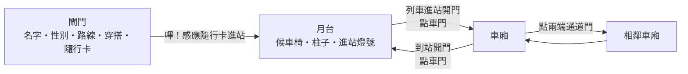

**月台畫面（Platform View）**

| 元素 | 規格 |
|---|---|
| 版面 | 640×360 像素，鏡頭站在月台上面向軌道：吊掛站名牌、對向牆面（地下站）或天際線（高架站）、月台門、黃色警戒線、地磚、兩張候車椅、兩根柱子 |
| 月台門 | 地下站為全高玻璃門、高架站為半高閘門；與列車車門對齊，開關同步 |
| 進站燈號 | 列車進站與開門時，月台門上方的燈號閃爍、月台邊緣燈條亮起；關門時改為警示色快速閃爍 |
| 列車班次 | 本機模擬：候車 → 進站減速（約 5 秒）→ 開門停靠 → 關門警示音 → 出站加速 → 下一班；HUD 顯示「下一班車 ▸ N 秒」 |
| 虛擬乘客 | 一開始就有人坐在椅子上或在車門兩側排隊；開門時先有人下車走出月台，排隊的人再上車；列車離開後陸續有人走進月台 |
| 自己 | 從閘門走進月台。點候車椅 → 走過去坐下；點地面 → 走過去站著；點**開著的車門** → 走進車門上車 |
| 上車 | 走到車門時才向伺服器要座位（§15.5）；車門會等玩家走到再關。沒搭上（連線失敗）就回到月台等下一班 |

**下車**

- 車廂內每到一站，車門會自動滑開；關門警示音響起前都可以下車。
- 點**車門**（或底部的「🚪 下車」）即下車：畫面淡出切到該站月台，剛才那班車還停著、門開著，玩家從車門走出來，接著列車關門出站。
- 行駛中點車門只會提示「列車行駛中，到站開門後才能下車」。
- 下車即結束這趟旅程：車票記下上車站、下車站與最後的座位。再次上車開始新的一趟。

### 15.2 角色自訂與頭頂名字

| 項目 | 規格 |
|---|---|
| 名字 | 閘門必填，最多 **8 個字**（依字素計算）；留白時請玩家先取名 |
| 性別 | 男／女二選一，決定角色外觀 |
| 外觀差異 | 女生：及肩長髮（背面看得到長髮蓋過肩膀，連帽外套款綁馬尾）、斜瀏海、肩膀較窄；上班族與學生款穿裙子。男生：短髮、領帶或制服。4 種穿搭 × 2 種性別 × 正面／背面 |
| 頭頂標示 | 月台與車廂裡**每個人**頭上都有名字；自己的名字用奶茶色底以便辨認。以 DOM 疊在畫布上，任何倍率下中文都清楚 |
| 審核 | 名字走霧氣留言同一套過濾（§7.7）：聯絡方式、詞庫、自傷字詞都不能當名字，被擋時伺服器改用「旅人」；閘門端也先擋明顯的聯絡方式 |
| 記憶 | 名字與性別只存在本機 `localStorage`，下次自動帶入 |
| NPC | 從一份常見暱稱名單隨機取名，同一個畫面內不重複；不計入車票上的同車人數 |

> 有了名字後，「完全匿名」改為「不需註冊、名字隨你取」。微光仍然**不帶送出者**，收到的人只知道「有人」。

### 15.3 車廂內自由移動

| 操作 | 結果 |
|---|---|
| 點**空座位** | 換到那個位子坐下（舊位置淡出、新位置淡入） |
| 點**走道或立柱旁** | 站起來拉吊環：站到離點擊處最近的空站位（`S1`～`S6`，與座位同一欄），舉手握住從橫桿垂下的吊環 |
| 站著時 | 狀態按鈕收起，改顯示「拉著吊環・點空位坐下」；寫在車窗時用自己那一欄的窗 |
| 點兩端的**通道門**（或頂部 ◀ ▶） | 穿過貫通道到相鄰車廂（交叉淡化）；第 1 節不能再往前、最後一節不能再往後 |

**車廂切換（跨車廂漫遊）**

- 一列車有 **4 節車廂**，共用同一個列車時鐘：換車廂時窗外景色連續，到站時所有車廂一起開門。
- 頂部顯示「第 N/4 節」。換過去的車廂裡有誰就看到誰（伺服器回傳該節的完整快照）。
- 相鄰車廂真人已達 12 人時不能過去（「隔壁車廂人太多了」）。

### 15.4 禁止飲食與微光

> 微光的三個選項已由 §17.1 的四種互動取代。

- 依台灣捷運車廂內「禁止飲食」的日常規定，**移除喝咖啡狀態與遞咖啡互動**。狀態剩 🪟 看窗外、🎧 戴耳機、📖 閱讀、😴 補眠。
- 微光改為三種安靜的鼓勵，點其他乘客後選一種：

| 種類 | `kind` | 收到的人看到（只有自己） |
|---|---|---|
| 🙂 點頭致意 | `nod` | 有人對你點了點頭。 |
| ✨ 遞上微光 | `light` | 有人遞給你一點微光。 |
| 🤝 拍拍肩膀 | `pat` | 有人輕輕拍了拍你的肩膀。 |

- 車票上的「收到的咖啡」改為「收到微光 ×N」；分享連結格式升為第 2 版（不含咖啡次數）。

### 15.5 即時協定增修（相對 §7.2）

| 方向 | 事件 | 內容 |
|---|---|---|
| C→S | `board` | 新增 `name`、`gender`；在月台走進車門時才送出 |
| C→S | `alight` | 只在停站開門時成功，否則 `NO_TARGET` |
| C→S | `seat:move` | `{ seat: SpotId }`，座位或站位；目標有人時 `NO_TARGET` |
| C→S | `car:move` | `{ dir: -1 \| 1 }`，回傳新車廂的 `BoardedSnapshot`（新的 resumeToken） |
| S→C | `pax:move` | `{ pid, seat }`：有人換座位或站起來 |
| S→C | `pax:join` | `via: 'door'`（從月台上車）或 `'gangway'`（從隔壁車廂走過來） |
| S→C | `pax:leave` | `reason: 'station'`（下車）或 `'transfer'`（走到隔壁車廂） |

- `Passenger` 新增 `name`、`gender`；`seat` 型別改為 `SpotId = SeatId | 'S1'…'S6'`。
- `BoardedSnapshot.room` 新增 `train`（列車編號，車票用）、`car`、`cars`。
- **分流**（§7.4 修訂）：以「節」為單位沿用原規則——未滿 8 人的車廂挑最熱鬧的；都滿 8 人時挑最空的；全部 12 人才加開一列新車（4 節，各自由 NPC 補熱度，玩家先進中間那節）。
- 月台只在本機模擬，不同步其他真人。連線時上車的那一刻才進入伺服器的列車，所以月台看到的班次與上車後的列車位置可能不同，以交叉淡化帶過（已知簡化，見 §15.6）。

### 15.6 已知簡化與後續

- 月台不是多人場景：看不到其他真人在等車。後續可讓月台訂閱「下一班進站列車」的時刻，讓月台班次與伺服器列車一致。
- 站著的人一律是拉吊環姿勢，不另外顯示耳機、閱讀等狀態。
- 名字標籤在人很多時可能重疊；後續可加「只顯示附近的名字」開關。

---

## 16. UI/UX 優化：載入畫面、進站車站選擇、車廂穿梭、底部標籤、霧氣字清晰度

> v1.3 新增。

### 16.1 過場載入畫面（Loading Screen）

| 時機 | 大字 | 最短顯示 |
|---|---|---|
| 開啟網頁 | 列車準備中… | 0.9 秒（等場景模組下載，最多 2.5 秒） |
| 閘門 → 月台 | 正在走進○○月台… | 1.2 秒（同時連線伺服器） |
| 月台 → 車廂 | 列車即將出發… | 0.9 秒（同時向伺服器要座位） |
| 車廂 → 月台 | 正在走到○○月台… | 0.8 秒 |
| 換車廂 | 正在切換至第 N 車廂… | 0.7 秒 |

- **動畫**：純 CSS 像素動畫「列車在隧道中穿梭」：隧道燈與牆面往後退，一列路線色的列車以 `steps()` 一格一格穿過；寫在 `index.html`，JS 還沒載入前就能顯示。
- **提示小字**：隨機一句 TPRT 提示（車廂內禁止飲食、站在黃線後方、博愛座、點車門下車、通道門換車廂、車窗寫字、補眠），換車廂時改為方向提示。
- 「減少動態」時動畫停止，只留靜態畫面與文字。

### 16.2 路線與進站車站選擇

- 閘門分成兩步：**① 乘客資料**（名字、性別、穿搭、隨行卡）→ **② 路線與進站車站**。
- 第 ② 步先選路線，下方出現該路線的**直式路線圖**：路線色帶上每一站一個站點，顯示中英文站名、站碼、地下／高架、可轉乘的路線；點一站即選為進站車站，按鈕變成「嗶！從○○進站」。
- 月台的吊掛站名牌、對向牆的大站名板、新增的**路線圖看板**（整條線的站名，本站放大並插上小旗）都依所選路線與車站呈現。
- **站名一律使用北城捷運 TPRT 虛構路網**（§3）。需求範例中的真實路線與站名（板南線、台北車站…）不會出現在遊戲內。

### 16.3 車廂穿梭的視覺引導

- 車廂兩端通道門上有**會動的像素箭頭**（三個 ❮／❯ 依序亮起，往門外推），旁邊有清楚的指示牌「❮ 第 2 車廂」／「第 4 車廂 ❯」，可直接點；第 1 節與最後一節沒有往外的那一側不顯示。
- 點門、指示牌或頂部 ◀ ▶ 時：
  1. 播放即時合成的「穿過車廂連接處」音效：門閂「咔」→ 帶通濾波掃頻的風聲 →「咔」。
  2. 顯示載入畫面「正在切換至第 N 車廂…」。
  3. 回到畫面時，舊車廂往反方向滑出、新車廂從前進方向**滑入**（0.6 秒，位置對齊實體像素）。

### 16.4 底部選單：圖示＋中文標籤

| 位置 | 圖示 | 標籤 | 說明 |
|---|---|---|---|
| 第一個 | ✍ | 車窗寫字 | 原本的「窗戶」圖示意義不明，第一個按鈕改為車窗留言 |
| 角色狀態（直排小標） | 👀 🎧 📖 😴 | 看窗外／聽音樂／專注模式／補眠 | 專注模式即番茄鐘 |
| 停站時 | 🚪 | 下車 | 主色按鈕 |
| 其他 | 🎚 🎫 | 音效／車票 | — |

每個按鈕圖示下方都有看得到的中文字，滑鼠移上去另有更完整的說明（`title`）。

### 16.5 車窗霧氣字的清晰度

> 已由 §17.2 取代：粗體＋二值化＋雙層描邊會讓多筆畫的字黏在一起。

- **字型**：粗體 13 px（原 11 px），逐字排版、字距 1 px，行高 16 px，每行 4 字；字形以系統中文字型繪製後二值化成像素筆劃。
- **雙層描邊**：筆劃處擦開霧氣；緊貼筆劃一圈（含右下陰影）是**深色水痕**，再外一圈是**亮白霧氣**。亮背景（晨間天空）靠深色描邊、暗背景（夜景、隧道）靠亮白邊框，兩種情況都讀得出來。
- **字型授權**：需求提到的 Zpix 免費授權僅限個人用途，商用需另購；正式版若要換像素中文字型，建議用 SIL OFL 授權的「俐方體 11 號（Cubic 11）」，打包成本地字型檔，不從第三方 CDN 載入。

### 16.6 順手修正

- 晨／夜切換時，窗外雨絲的 ParticleContainer 仍指向已釋放的舊貼圖，整個畫面停止渲染（每天 6:00、17:00 自動切換時都會觸發，自第一版即存在）。現在換美術時一併換上新貼圖。

---

## 17. 互動選單與車窗字體

> v1.4 新增。§15.4 的三種微光由本章四種互動取代。

### 17.1 對其他乘客的四種互動

點其他乘客會跳出 2×2 選單，標題是「給 ○○（對方不會知道是誰）」。每個選項有圖示、名稱和一行說明，說明會依對方此刻的狀態改變。

| 互動 | `kind` | 全車看到 | 收到的人（只有自己） | 條件 |
|---|---|---|---|---|
| 🪪 嗶卡默契 | `beep` | 對方頭上亮一下、浮出「嗶！」 | 一聲短促的「嗶」（送出者也聽得到）＋「有人刷了一下隨行卡：嗶！跟你打聲招呼。」 | — |
| 🎵 同頻波紋 | `wave` | 對方在聽歌：頭頂 5 根音樂波形跟著節拍跳 3 秒、浮出「♪」；其他狀態：溫暖微光 | 「有人跟你同頻，一起聽著這首歌。」／「有人遞給你一點溫暖的微光。」 | — |
| 💤 蓋上小毯 | `blanket` | 半透明的條紋像素小毯，從胸口蓋到腿上，淡入 0.6 秒；對方醒來、下車或 5 分鐘後消失 | 「有人幫你蓋上一條小毯子。好好睡。」 | 對方正在補眠；否則選項變灰，顯示「對方補眠時才能蓋」，伺服器也會拒絕 |
| 📜 遞幸運籤 | `fortune` | 對方頭上微光、浮出「📜」 | 「有人遞給你一張籤：『今日搭車必定有座』（小吉）」 | — |

- **幸運籤**：籤由伺服器從 12 支籤（`FORTUNES`，大吉／中吉／小吉）中抽，事件與 ack 只帶索引，不帶任何使用者文字。送出者也會看到自己遞出哪一支。
- **匿名**：沿用 §4.6，事件不帶送出者；對方開勿擾時靜默丟棄，送出者仍看到成功。
- **頻率**：沿用每人每分鐘 10 次、對同一人 2 分鐘 1 次；太頻繁時提示「剛剛才互動過，讓對方靜一靜吧。」
- **協定**：`GlowKind = 'beep' | 'wave' | 'blanket' | 'fortune'`；`glow:send` 的 ack 為 `{ fortune: number | null }`；`glow` 事件多一個 `fortune` 欄位。

### 17.2 車窗字體筆劃與渲染

**問題**：v1.3 的霧氣字用粗體、二值化，外加兩圈描邊，「繁、鬱、聽」這類多筆畫的字會黏成一團。

**根本原因**：遊戲以 640×360 像素繪製後放大，每個字只有約 12～13 個像素高。這個高度放不下「鬱」的筆劃，換任何點陣字型都一樣。

**做法**：
- **分層**：霧氣與水珠留在像素層；留言文字改畫在**螢幕解析度的疊層**。疊層跟著同一個鏡頭（直式拖曳、換車廂滑動、淡入淡出都同步），裁在遊戲畫面範圍內，文字依實際的裝置像素倍率光柵化。
- **細筆劃**：一般字重（不用粗體），不加實心描邊。字色是「擦開霧氣後露出的深色」，外圍一圈低透明度的亮霧柔光（`dropShadow`，距離 0、模糊 1.6），不會填進筆劃之間的空隙。
- **一致的底色**：文字範圍內的霧稍微濃一點，不論窗外是晨光還是夜景，字的底色都差不多。
- **動態字級與字距**：
  - 3 個字以內：14 px，每行 3 字。
  - 其他：12 px，每行 4 字。
  - 一行裡有多筆畫的字（以墨量判斷）時，字距由 0.7 放寬到 1.4 px；超出窗寬時以 0.5 px 為單位縮小字級，最小 9 px。
- **淡出**：留言以 6 階量化淡出，維持像素遊戲的節奏感。

**字型**：目前用系統中文字型（蘋方、思源黑體、微軟正黑體）。需求中提到的字型：
- **Zpix**：授權僅限個人免費使用，商用需另購。
- **文泉驛等寬微米黑**：GPL 授權，打包進網頁有授權傳染的疑慮。
- **俐方體 11 號（Cubic 11）**：SIL OFL 授權，可以商用。正式版要換點陣風字型時建議用它，打包成本地字型檔，不從第三方 CDN 載入。

### 17.3 車票上的旅程統計

撕線以下改為：

```
📖 專注模式 ×2
🪪 嗶卡 ×1　🎵 波紋 ×0　💤 小毯 ×1　📜 籤 ×1
收到的籤：「今日搭車必定有座」小吉        ← 這趟有收到籤時才印（最近的一支）
和 3 位陌生人安靜地同行了一段路
「語錄」
你在車窗上寫下：「……」                  ← 勾選時才印；放不下時以「…」截斷，不壓到序號
```

- 只算**收到的**互動，送出的不算；每次上車重新計算。
- 分享連結格式升為第 3 版：`[3, 線, 起, 迄, 座位, 上車時間, 分鐘, 專注, 嗶卡, 波紋, 小毯, 籤, 籤號(-1=無), 同車人數, 語錄, 夜間, 卡面, 列車]`。仍然只有代碼與數字，籤號對應固定的 `FORTUNES` 清單。
- 落地頁與 OG 預覽圖同步顯示四種次數（OG 為 `FOCUS 2  BEEP 1 WAVE 0 NAP 1 LUCK 1`），落地頁也印出收到的籤。

---

## 18. 月台轉乘與環形輪盤選單

> v1.5 新增。§17.1 的 2×2 互動選單由 §18.2 的輪盤取代，四種互動的規則不變。

### 18.1 在月台直接轉乘

在轉乘站（中央站：城心線 ⇄ 河岸線；展覽館：城心線 ⇄ 雲橋線）不必回閘門，在月台就能換到另一條線。

**月台上的連通道**
- 月台右下角有一個往下的**樓梯口**：欄杆頂端漆上目標路線色，踏階越往下越暗。
- 樓梯口旁立一支**像素轉乘指示牌**：路線色方塊、路線代號、往下的箭頭。
- 上方浮著可以點的指示牌文字，例如 `往 河岸線 RV ❯`，框線是目標路線色，跟車廂通道門的指示牌同一套樣式。
- 一站若有第二條轉乘線，放在左下角（`❮ 往 … `）。目前路網每站最多一條。
- 底部提示列在轉乘站多一句「點轉乘指標換線」。

**轉乘流程**
1. 點指示牌或樓梯口：角色從長椅站起來，走到樓梯口，往下走進連通道並淡出。
2. 播放即時合成的**車站廣播鈴**（原創四音上行，不使用任何真實車站錄音），接著是一串在通道裡回響、越走越遠的**腳步聲**；Lo-Fi 音量暫時壓低。
3. 載入畫面：大字「正在穿過連通道，前往河岸線月台…」，下方是轉乘提示，火車圖示換成目標路線色；至少顯示 2.4 秒。
4. 抵達新路線的月台：角色從同一個連通道的樓梯走上來。站名牌、牆面色帶、路線圖、長椅顏色與列車外觀都換成新路線；地下／高架也跟著變（例如展覽館的城心線月台在地下、雲橋線月台在高架，看得到天空）。
5. 字幕：「這裡是中央站，河岸線月台。」接著照常等該路線的列車進站。

**連線**
- 在月台上不屬於任何列車房間（下車時已離開），所以轉乘不需要通知伺服器；下一次上車時以新路線向伺服器要座位，伺服器才分配那條線的列車。
- 離線模式行為相同。
- 車票明信片記的是**實際搭乘的那條線**：轉乘後仍可打開上一趟的車票，不會被新路線蓋掉。

### 18.2 環形輪盤互動選單

點其他乘客時，在他身上展開一個圓形輪盤，取代原本帶說明文字的 2×2 選單。

**外觀**
- 直徑約 180 px，以點擊位置為中心；靠近畫面邊緣時往內收，整個輪盤留在畫面內。
- 四等分扇形，扇形之間留細縫；中心是「✕ 關閉」。
- **只有圖示、沒有文字**：每個扇形一個 12×12 的單色像素圖示（2 倍放大、銳利邊緣）。功能名稱只提供給螢幕閱讀器（`aria-label`）。
- 晨間是燕麥色半透明底、深色圖示；夜間是煙灰色半透明底、燕麥色圖示。

**扇形配置**（順時針，從正上方開始）

| 位置 | 圖示 | 互動 | 可用條件 |
|---|---|---|---|
| 上 | 🪪 卡片 | 嗶卡默契 | 隨時 |
| 右 | 🎵 音符與波紋 | 同頻波紋（對方聽音樂時一起跳動，否則送上微光） | 隨時 |
| 下 | 💤 小毯與 z | 蓋上小毯 | 對方**補眠**時才亮；否則灰色半透明、不能點 |
| 左 | 📜 籤紙 | 遞幸運籤 | 隨時 |

**操作手感**
- 展開：由 60% 放大並帶一點旋轉淡入（160 ms）。
- 懸停或鍵盤聚焦：扇形亮起莫蘭迪暖光（奶茶色半透明＋柔光），圖示變亮，並播放很輕的「喀」聲（即時合成）。灰掉的扇形不亮也不出聲。
- 選擇：輪盤向外放大到 135% 並淡出（220 ms），同時送出互動。
- 點輪盤外的地方或按 Esc 關閉。
- 鍵盤：方向鍵直接對應上、右、下、左四個扇形；Enter 或空白鍵選擇。
- 開啟「減少動態效果」時不播放展開與淡出動畫。

**互動回饋**（沿用第 17 章）
- 效果與粒子直接出現在對方頭頂。
- 對方只在畫面上方收到一則單向的靜謐提示，不知道是誰送的，也不能回覆。

### 18.3 音效面板的勿擾與關閉方式

- **勿擾模式**改為開關樣式，寫清楚擋掉的是哪些互動：
  - 關閉：「🔔 勿擾模式：關閉｜會收到別人的嗶卡、同頻、小毯、幸運籤」
  - 開啟：「🔕 勿擾模式：開啟｜別人的嗶卡、同頻、小毯、幸運籤都不會打擾你」
  - 規則不變：伺服器靜默丟棄，送出者仍看到成功（§4.6）。
- **點畫面空白處就收起音效面板**：面板後面墊一層透明遮罩，點到它只收起面板，這一下不會穿透到遊戲畫面（不會順便走路或點到人）。底部按鈕疊在遮罩上面，開著面板時照樣能按；按 Esc 也能收起。

---

## 19. 月台與伺服器列車同步

> v1.6 新增。修正：連線時從月台上車，伺服器原本只依「哪節車廂最熱絡」分流，不管那班車開到哪裡，車票上的上車站因此可能和走進的月台不同（例如從展覽館進站，車票卻寫茶山）。

### 19.1 規則

- 連線時，月台上進站、開門、關門離站的時間都照**伺服器那班車**的時間；走進車門時坐進的就是那班**正停在這站**的車。上車後的「下一站」、車票上的上車站都對得上。
- 走進月台（包含下車、轉乘之後）先問伺服器下一班：
  1. 這條線上有列車正停在這站、或正開往這站，而且 **60 秒內**會到 → 等那一班，和車上的人同車。只看正在跑的這一段，因為再下一段的行駛時間要等發車才決定。
  2. 沒有 → 預定**從這站加開一班**，10～16 秒後進站。這時還不會真的開出列車，有人在開門期間上車才開出，所以只站在月台上的人不會用掉伺服器資源。同一站的人等的是同一班預定列車。
- 加開列車從上一站開過來；終點站則從另一側進站、停妥後折返，方向和月台上「往○○」一致。
- **上車條件**：那班車停在這站、車門開著。發車後 2 秒內仍容許（網路延遲），太早或太晚回 `MISSED`，畫面顯示「這班車沒搭上，等下一班吧」並回到月台。
- 開門後走向車門的途中車門就關了（連線時不會為你延後發車）：照舊提示「車門關了，下一班車很快就來」。
- 月台各階段以**真實時鐘**計：切到別的 App 再回來時，月台會追上伺服器的列車，不會停在離開前的畫面。

### 19.2 協定

- 新增 `platform:next { line, station }` → `{ train, arriveAt, departAt, dir }`（伺服器時鐘；用戶端換算成本機時間）。每個連線每分鐘 20 次。
- `board` 多了選填的 `station`、`train`。帶了就只能坐進那班車；沒帶時（斷線重連、座位沒保留住）照舊分流到這條線最熱絡的車廂。
- 新增錯誤碼 `MISSED`。
- 設定：`platformWaitSec`（預設 60，環境變數 `PLATFORM_WAIT_SEC`）、`platformLeadSec`（10～16）。

### 19.3 離線模式

不變：月台在本機隨機排班，開門時點車門就上車。
